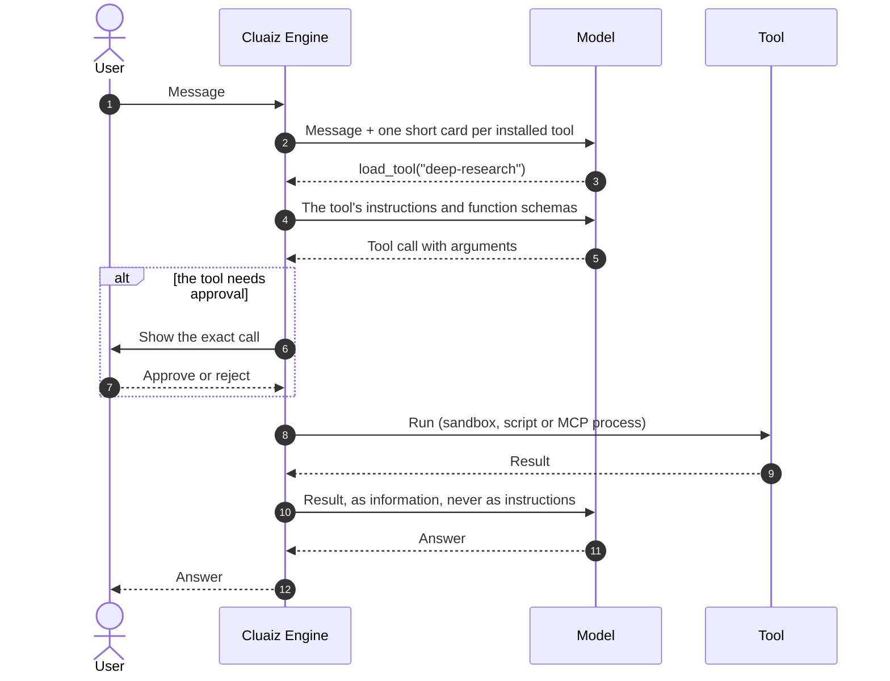
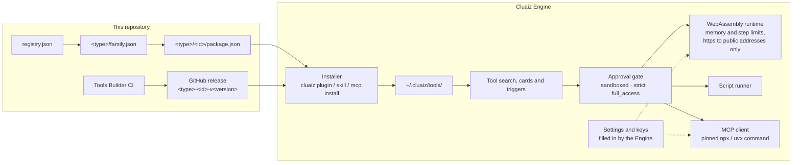

<p align="center">
  
</p>

<h3 align="center">
Skills, plugins and MCP servers that give the models in Cluaiz real abilities: search the web, read documents, run code, work with files, Git and browsers, and write cited reports</h3>

</br>
<p align="center">
  
  
  
  
</p>

<p align="center">
  <a href="docs/README.md"><b>Documentation</b></a> &nbsp;|&nbsp;
  <a href="https://cluaiz.com"><b>Website</b></a> &nbsp;|&nbsp;
  <a href="https://github.com/cluaiz/cluaiz"><b>Engine</b></a> &nbsp;|&nbsp;
  <a href="https://discord.gg/mab8kBURz"><b>Discord</b></a>
</p>

> [!WARNING]
> **Pre-release.** Every tool starts at v1.0.0 together with the Engine's first pre-release. Tool formats and
> manifests can still change before the stable release. Please report what breaks.

## About Cluaiz Tools

[Cluaiz](https://github.com/cluaiz/cluaiz) is one system for working with AI: run models on your own hardware,
serve them to your apps, and let them do real work, for yourself or for your business. A model on its own can only
write text. **Tools** let it act: look things up, read and write files, run code, use a browser, call services.

This repository is the official registry of those tools:

- **22 tools** in three types: WebAssembly plugins, skills and MCP servers.
- **Installed with one command** (`cluaiz plugin install web-search`), with no setup for most of them.
- **Loaded only when needed.** The model sees one short line per tool until it asks for one, so tools fit even a
  4K or 8K context of a small model.
- **Run under the Engine's rules:** plugins in a WebAssembly sandbox, MCP servers and scripts after your approval,
  your keys never shown to a tool.
- **Open formats:** [Agent Skills](https://agentskills.io) (`SKILL.md`), the
  [Model Context Protocol](https://modelcontextprotocol.io) and WebAssembly. A tool written for Cluaiz is not
  locked to Cluaiz, and many existing MCP servers and skills work here as they are.

## Quick Start

You need the [Cluaiz Engine](https://github.com/cluaiz/cluaiz#quick-start) installed.

```bash
cluaiz plugin install web-search      # a WebAssembly plugin
cluaiz skill install deep-research    # a skill (it installs web-search too, as a dependency)
cluaiz mcp install filesystem         # an MCP server (needs Node.js)

cluaiz plugin list                    # what is installed, with versions
```

Then ask in the terminal agent or through the API, and the model picks the tool:

```bash
cluaiz agent -m qwen3-4b-gguf-Q4_K_M
> Do deep research on SQLite vs DuckDB for a desktop app and save a cited report.
```

Some tools work better with a setting. Settings belong to one tool and are never shown to the model:

```bash
cluaiz plugin config web-search TAVILY_API_KEY    # a free key gives dependable web search
```

## Tool types

| Type | What it is | Runs as | Needs on your machine | Choose it when the tool must |
| :--- | :--- | :--- | :--- | :--- |
| **Plugin** | Functions compiled to one WebAssembly file | Inside the Engine, in a sandbox | Nothing | Compute from its input, or call public `https` services |
| **Skill** | Instructions in `SKILL.md`, optionally with scripts | Instructions for the model; scripts as normal programs | Nothing, or the script's language (Python) | Teach the model a way of working, or run a small script |
| **MCP server** | An outside program that speaks MCP | A separate process the Engine starts | Usually Node.js or `uv` | Use files, programs or a service that already has an MCP server |

**Extensions** in [`extensions/`](extensions/) are mini-apps for the Cluaiz App. They are experimental, are not
in the registry, and the Engine does not run them.

[Skills, plugins, MCP and extensions](docs/architecture/plugin_vs_mcp_vs_extension_vs_skill.md) explains the
differences in detail.

## Catalog

### Plugins (WebAssembly)

| Plugin | What it does | Network |
| :--- | :--- | :--- |
| `math` | Evaluates math expressions: arithmetic, powers, roots, trigonometry, logarithms | No |
| `text` | SHA-256, Base64, regular expressions, line diffs and counts | No |
| `time` | The date and time on this computer, and date arithmetic | No |
| `rank` | Ranks documents it is given against a query. It cannot read files | No |
| `web-search` | Searches the web and reads pages. Works without a key; a free key or SearXNG makes it dependable | `https` only |

### Skills

| Skill | What it does |
| :--- | :--- |
| `deep-research` | Plans a research question, searches and reads pages onto disk, and writes a cited Markdown report |
| `code-reviewer` | Reviews code for bugs, security problems and duplicated logic |
| `code-interpreter` | Runs code in Python, JavaScript, Rust, Go and more, and returns its real output |
| `build-feature` | Understand, plan, write a failing test, build and verify a feature or a fix |
| `frontend-design` | Rules for pages and screens that look finished and work for everyone |
| `git-assistant` | Commit messages, checks of staged changes, and merge conflicts |
| `github` | Issues, pull requests, CI runs and search through the GitHub CLI |
| `speech` | Speech to text and text to speech with the Engine's own speech models |
| `tool-creator` | Creates new skills, plugins and MCP servers for Cluaiz |
| `learn-cluaiz` | Explains Cluaiz, its Engine and its tools |

### MCP servers

| Server | What it does | Needs |
| :--- | :--- | :--- |
| `browser` | Opens pages in a real browser, clicks and types, and tests a site: errors, console, failed requests, accessibility | Node.js and a Chromium browser |
| `filesystem` | Reads, writes and searches files in the open folder | Node.js |
| `git` | Reads a repository, and stages, commits and branches | `uv` |
| `fetch` | Fetches a page as Markdown | `uv` |
| `documents` | Reads PDF, Word, Excel, PowerPoint and more as text | `uv` |
| `context7` | Current documentation for programming libraries | Node.js, internet |
| `everything` | The official MCP test server, for checking that MCP works | Node.js |

Every MCP server is pinned to an exact version of its package, so an update upstream never changes what you run.

## How a tool reaches the model



- **Cards first.** Every installed tool costs the model one short line: its name and when to use it. The full
  instructions and schemas arrive only after the model asks with `load_tool`, and they leave again when they are
  no longer used. This keeps small contexts free for the actual work.
- **Triggers.** Words in a tool's `package.json`, such as "deep research" or "summarize this pdf", let the Engine
  offer the right tool for a message before the model asks.
- **One loop for everyone.** The terminal agent (`cluaiz agent`) and the API (`/v1/chat/completions`) use the same
  turn logic, so a tool behaves the same in both. Details: [turn lifecycle](docs/architecture/turn-lifecycle.md).

## What powers the tools



| Part | What it does |
| :--- | :--- |
| **Registry** | `registry.json` lists the families, each `family.json` lists its tools, and each tool's `package.json` describes it: description, triggers, functions, permissions, files and versions. |
| **Releases** | When a `package.json` changes on `main`, CI builds that tool and publishes a GitHub release named after it, such as `plugin-web-search-v1.0.0`, with a ZIP of its files and, for a plugin, its `.wasm`. |
| **Installer** | `cluaiz <type> install <id>` reads the registry, downloads the release, installs dependencies (such as `web-search` for `deep-research`) and places the tool in `~/.cluaiz/tools/<type>/<id>/`. |
| **WebAssembly runtime** | Runs plugins in a sandbox with a memory limit (256 MB unless the manifest asks for less) and an instruction limit, so a loop that never ends becomes an error. A plugin has no file access, and reaches the network only through one Engine function, only over `https` to public addresses, and only if its manifest asks for it. |
| **Keys** | A plugin writes `{{secret:NAME}}` in a request header and the Engine fills it in, only for the host the manifest names. The plugin never sees the key. |
| **Approval gate** | In the default `sandboxed` mode, MCP calls and tools that can write files, run commands or use the network ask before they run, showing the exact call. `strict` asks for everything; `full_access` asks only for what you marked. |
| **MCP client** | Starts the pinned command, talks MCP to it, and stops it with the Engine. |

## Write your own tool

### For yourself

You do not need this repository or a release to use your own tool:

| Way | How |
| :--- | :--- |
| **A skill in your project** | Write `.agents/skills/<name>/SKILL.md` in your project folder. The agent finds it there, with no install step. [Quickstart](docs/get-started/quickstart.md) |
| **Any tool on your computer** | Put its folder in `~/.cluaiz/tools/<type>/<id>/` with its `package.json`. The Engine picks it up like an installed tool. |
| **Let the model build it** | Install `tool-creator` and ask: "create a plugin that counts words". It writes the files and tells you what is left to do. |

### For everyone

To add a tool to this registry, so that `cluaiz <type> install <id>` works for every user, read
[CONTRIBUTING.md](CONTRIBUTING.md). In short: open a tool proposal issue, build it with the guides below, test it
with a small model, and open a pull request.

| You want to | Read |
| :--- | :--- |
| Write your first skill | [Quickstart](docs/get-started/quickstart.md), [first skill](docs/skills/tutorial-first-skill.md) |
| Build a WebAssembly plugin | [First plugin](docs/plugins/tutorial-first-plugin.md), [WebAssembly ABI](docs/plugins/wasm-abi-guide.md) |
| Connect an MCP server | [Connect a server](docs/mcp/tutorial-connect-mcp.md) |
| Know every `package.json` field | [Package specification](docs/package-spec.md) |
| See how the Engine uses a tool | [Engine integration](docs/architecture/engine-integration.md) |
| Find any other topic | [Documentation map](docs/README.md) |

## Repository layout

| Path | What it holds |
| :--- | :--- |
| [`plugins/`](plugins/) | WebAssembly plugins, each with `package.json`, `SKILL.md`, `README.md` and Rust source |
| [`skills/`](skills/) | Skills, each with `package.json`, `SKILL.md`, `README.md` and optional `scripts/` |
| [`mcp/`](mcp/) | MCP server packages: a `package.json` with the pinned command, plus `SKILL.md` and `README.md` |
| [`extensions/`](extensions/) | Experimental App mini-apps, not released |
| [`docs/`](docs/) | Guides, specifications and architecture |
| [`registry.json`](registry.json) | The entry point the Engine reads |
| [`.github/`](.github/) | The Tools Builder workflow and issue templates |

## Community

- **Found a bug in a tool?** [Open an issue](https://github.com/cluaiz/cluaiz-tools/issues/new/choose) with the
  tool's version and what you asked.
- **Missing a tool, or have an idea?** Open a tool proposal. Tools people ask for are the ones we build next.
- **Want to talk or help?** Join the [Discord](https://discord.gg/mab8kBURz).
- **Found a security problem?** Report it privately, as [SECURITY.md](SECURITY.md) describes.

What Cluaiz is building toward: [VISION.md](VISION.md).

## License

Cluaiz Tools is released under the [Apache License 2.0](LICENSE). A tool that bundles or starts someone else's
software keeps that software's own license, named in its `package.json`.
