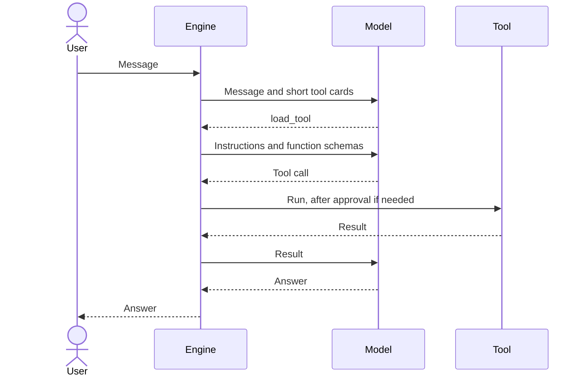

<p align="center">
  
</p>

<h1 align="center">Cluaiz Tools</h1>

<p align="center">
  <strong>The registry of skills, plugins and MCP servers for the Cluaiz Engine.</strong>
</p>

<p align="center">
  <a href="https://github.com/cluaiz/cluaiz-tools/actions"></a>
  <a href="LICENSE"></a>
  
</p>

---

The Engine runs models on your own hardware. Tools give those models real abilities. They install on their own, and nothing goes in the model's prompt until it is needed.

## Tool types

| Type | What it is | Needs on your machine |
|---|---|---|
| **Skill** | Instructions the model loads when needed, in the open Agent Skills format | Nothing |
| **Plugin** | A program the Engine runs for the model, usually one WebAssembly file in a closed sandbox | Nothing, for WebAssembly |
| **MCP server** | An outside program using the open Model Context Protocol | Usually Node or `uv` |

**Extensions** are App mini-applications. They are experimental, and the Engine does not run them.

[Skills, Plugins, MCP and Extensions](docs/architecture/plugin_vs_mcp_vs_extension_vs_skill.md) explains the differences.

## How it works



## Install a tool

```bash
cluaiz plugin install math
cluaiz skill install code-reviewer
cluaiz mcp install filesystem
cluaiz plugin list
```

The Engine reads `registry.json`, then `family.json`, then the tool's `package.json`, and installs into `~/.cluaiz/tools/`.

## Catalog

### Plugins

| Plugin | Kind | What it does | Status |
|---|---|---|---|
| `math` | WebAssembly | Evaluates math expressions | Runs |
| `text` | WebAssembly | Hashing, Base64, diffs and regular expressions | Runs |
| `time` | WebAssembly | The current date and time on this computer, with its UTC offset | Needs the next Engine release |
| `search` | WebAssembly | Ranks documents it is given. It cannot read files | Runs |
| `web-search` | WebAssembly | Searches the web and reads pages | Needs the next Engine release |

### Skills

| Skill | What it does |
|---|---|
| `code-reviewer` | Reviews code for bugs, security problems and duplication |
| `code-interpreter` | Runs code in several languages and returns its real output |
| `tool-creator` | Creates new skills, plugins and MCP servers |
| `learn-cluaiz` | An introduction to Cluaiz |
| `git-assistant` | Commit messages, checks before a commit, and merge conflicts |

### MCP servers

| Server | Needs | Command |
|---|---|---|
| `browser` | Node and a Chromium browser | `npx -y agent-browser@0.41.2 mcp --tools core,debug,network` |
| `filesystem` | Node | `npx -y @modelcontextprotocol/server-filesystem@2.2.0 .` |
| `everything` | Node | `npx -y @modelcontextprotocol/server-everything@2.2.1` |
| `context7` | Node | `npx -y @upstash/context7-mcp@4.5.1` |
| `fetch` | `uv` | `uvx mcp-server-fetch@2026.11.4` |
| `git` | `uv` | `uvx mcp-server-git@2026.11.4` |
| `documents` | `uv` | `uvx markitdown-mcp@0.0.1a8` |

## Write a tool

| You want to | Read |
|---|---|
| Write your first tool | [Quickstart](docs/get-started/quickstart.md) |
| Build a plugin | [Tutorial: first plugin](docs/plugins/tutorial-first-plugin.md) |
| Connect an MCP server | [Tutorial: connect a server](docs/mcp/tutorial-connect-mcp.md) |
| Understand everything | [Documentation map](docs/README.md) |
| Contribute | [Contributing](docs/get-started/contributing.md) |

## License

Cluaiz Tools packages and specifications are released under the [Apache-2.0 License](LICENSE), unless a package names its own.
