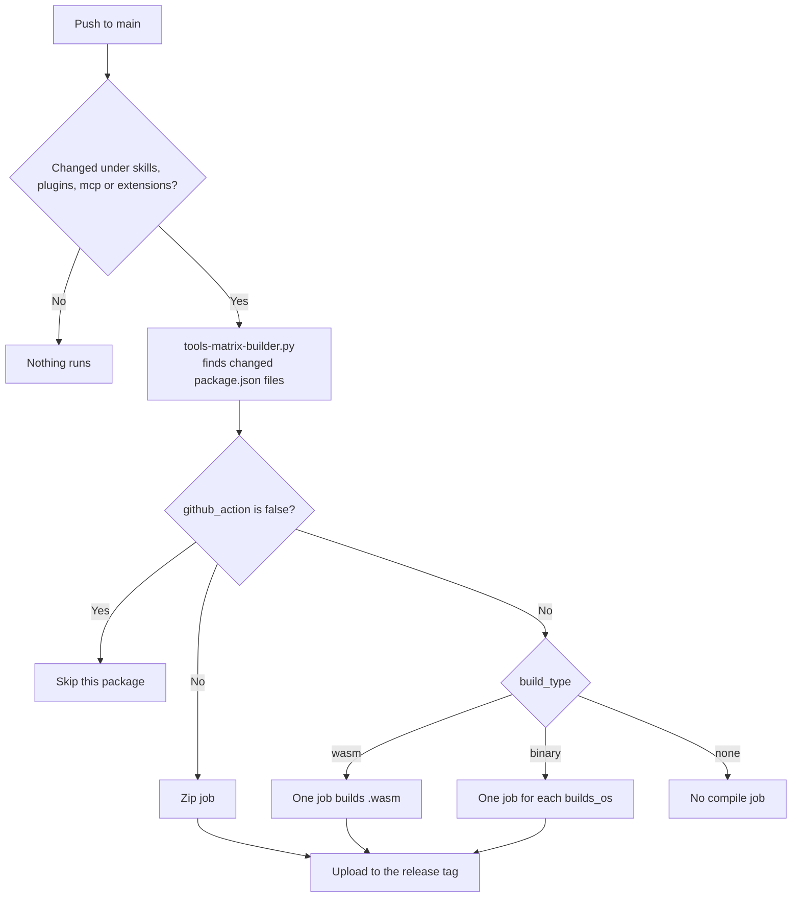

# Build pipeline

Authors do not compile or upload anything by hand. They push to `main`, and CI reads the changed `package.json` and builds what it asks for. [Build types](../plugins/build-types.md) explains how to choose a type.

## What CI builds

| `build_type` | Used by | Compiled output | Always produced |
|---|---|---|---|
| `wasm` | WebAssembly plugins | `<id>_v<version>.wasm` | `<id>-files.zip` |
| `binary` | Native plugins | `<id>_windows_x64.dll`, `lib<id>_linux_x64.so`, `lib<id>_macos_arm64.dylib` | `<id>-files.zip` |
| `none` or absent | Skills, MCP servers, script plugins | Nothing | `<id>-files.zip` |

The zip holds whichever of these exist: `package.json`, `README.md`, `SKILL.md`, `scripts/`, `references/`, `assets/`. It never holds source code or compiled files.

## How a build starts



**A build starts only when `package.json` changes.** The script looks at `git diff HEAD^ HEAD` for manifests. A change to `src/lib.rs` alone builds nothing, so bump `latest_version` in the same commit.

## Compiling WebAssembly

```bash
rustup target add wasm32-unknown-unknown
cargo build --release --target wasm32-unknown-unknown
```

The target must be `wasm32-unknown-unknown`. A `cargo build` without it makes a native library, and a `wasm32-wasi` build expects system functions the Engine does not provide. CI must check that the output starts with the WebAssembly bytes `\0asm` before publishing it.

`Cargo.toml` needs:

```toml
[lib]
crate-type = ["cdylib"]
```

## Release names

Each package version has one tag: `<type>-<id>-v<version>`, such as `plugin-math-v1.0.0`.

```
plugin-math-v1.0.0/
├── math-files.zip
└── math_v1.0.0.wasm
```

The Engine builds these addresses itself, so the names must match exactly. Pushing again for the same version replaces the files on the tag.

## Fields CI reads

| Field | Effect |
|---|---|
| `id` | Tag and file names |
| `latest_version` | Tag and file names |
| `build_type` | Which jobs run |
| `github_action` | `false` skips the package |
| `versions.<v>.builds_os` | Systems for a `binary` build |
| `title`, `description`, `versions.<v>.changelog` | Release page text |

## Adding a tool

1. Create the folder under the right family.
2. Add `package.json` and `assets/icon.svg`. Add `SKILL.md` and source if the type uses them.
3. Add the entry to that `family.json`.
4. Push. CI builds and releases it.
5. Install it from a clean `CLUAIZ_HOME` and call it, as [local testing](../tutorials/plugins/04-local-testing.md) shows.

## Rules for manifests outside tool folders

The script matches any changed `package.json` whose path contains `skills/`, `plugins/` or `mcp/`. That includes the sample files `docs/skills/package.json`, `docs/plugins/package.json` and `docs/mcp/package.json`, which are copies of the real `deep-research`, `web-search` and `browser` manifests. If one is changed in a commit that also triggers the workflow, the script can start a release for that id from the docs folder, so commit them separately from tools.
