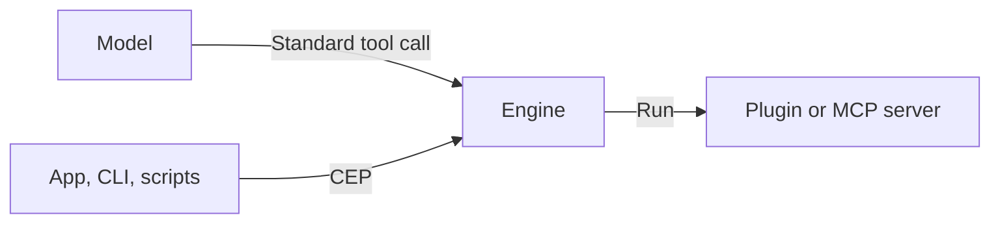

# From CEL to CEP

**CEL is gone.** The `inference-cel` crate was removed from the Engine, and nothing parses CEL now. Do not write CEL in a tool, and treat any CEL you find as out of date.

CEP does not replace CEL one for one, because CEL did two jobs and they are now separate.

## What CEL was

CEL was a small language the model wrote inside its answer:

```
let $math = use plugin::math -> invoke(calculate, expr: "10 * 5");
```

The Engine found this text, parsed it and ran the tool. The model had to learn a grammar that belonged only to Cluaiz.

## What replaced it

| Job | Before | Now |
|---|---|---|
| The model asks for a tool | CEL or `<TRIGGER:...>` in the answer | A standard tool call |
| A program asks the Engine for something | Named pipes and custom REST routes | CEP: `POST /v1/cep`, JSON-RPC 2.0 |



**The model never writes CEP.** CEP is for programs. A skill should never teach the model CEP or any special syntax. It names the function, and the model calls it the normal way.

## Old terms and what to use

| Old | Now |
|---|---|
| CEL, Cluaiz Execution Language | Standard tool calls, for the model |
| `use plugin::x -> invoke(...)` | A call to the function named in `functions` |
| `use mcp::x -> call_tool(...)` | A call to the server's tool |
| `<TRIGGER:plugin:x>` | `load_tool`, then a function call |
| `[PIVOT_CONTINUE]` | The next round of the turn, with the tool result |
| `cel_grammar` | `functions` with a JSON schema |
| `SkillRouter` | Tool matching. See [Engine integration](engine-integration.md) |
| `inference_cel::WasmExecutor` | The Engine's plugin runner |
| `cluaiz_entry`, `CxpPayload` | `execute_cel`. See [WebAssembly interface](../plugins/wasm-abi-guide.md) |
| MsgPack input | JSON input |
| `logic.wasm` | `<id>.wasm` |
| `wasm32-wasi` | `wasm32-unknown-unknown` |
| `.cell`, `.rhai` scripts | `execution` in `package.json` |
| `system_bindings`, `SETTINGS__*` | Not available. See [plugin settings](../tutorials/plugins/02-fetching-settings.md) |
| `vram_kv_inject`, `state.kvcache.bin` | Not available |
| Named pipe IPC | CEP |
| `cluaiz run "use plugin::..."` | CEP `tools.call` |

## One name that stays

The function every WebAssembly plugin exports is still called `execute_cel`. The name is historical and has nothing to do with the old language. The Engine looks for exactly that name, so it stays until the Engine and all plugins change together.

## How tools use CEP

| Tool | Uses CEP today? | Status |
|---|---|---|
| Skill | No. It instructs the model | Stays this way |
| WebAssembly plugin | No. It has host functions for the clock, the system name and `http_fetch` | Planned |
| MCP server | No built-in route | Planned |
| Script plugin | No built-in route | Planned |

The planned design adds one host function that passes a CEP request to the Engine, and each tool declares in `package.json` which CEP methods it needs, as a planned `cep` permission kind with `info` and `allow` like the others ([Permissions](../package-spec.md#permissions)):

```json
"permissions": {
  "cep": { "info": "Transcribes audio and reads the files it is given", "allow": true, "methods": ["audio.run", "fs.read"] }
}
```

The Engine would refuse any method that is not listed, and `system.exec` would stay refused by default. A new Engine feature would then reach plugins as a new CEP method, without changing the plugin interface.

**This is not built.** Do not use it in a tool yet. See [CEP and plugins](../tutorials/plugins/03-cep-architecture.md) and [CEP and MCP](../tutorials/mcp/03-cep-architecture.md).
