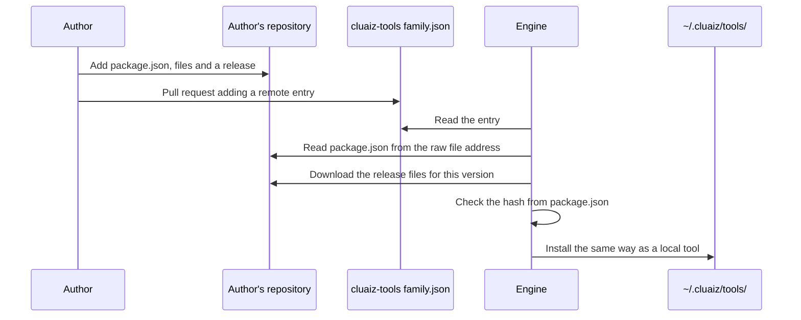

# Tools from other repositories

A tool does not have to live in `cluaiz-tools`. The registry can hold only a pointer, and the tool stays in its author's GitHub repository. This keeps the registry small and lets authors release on their own schedule.

**Status: Planned.** The file format below is the design, and `family.json` can already hold these entries. The Engine does not read them yet: `cluaiz plugin install <remote id>` answers "not found". Until it does, a tool must be listed with a local entry.

## The path of a remote tool



## What the author does

1. Create a repository holding the tool, laid out like a tool folder here:

   ```
   my-plugin/
   ├── package.json
   ├── SKILL.md            Optional for plugins and MCP servers
   ├── assets/icon.svg     Required
   └── src/                Source, for a built plugin
   ```

2. Release the files on GitHub, named as the [package specification](../package-spec.md#versions) describes, and list their full addresses under `versions`.
3. Open a pull request here that adds one entry to the right `family.json`:

   ```json
   "image-optimizer": {
     "type": "remote",
     "repo": "your-name/your-plugin",
     "branch": "main",
     "manifest_path": "package.json"
   }
   ```

| Field | Meaning |
|---|---|
| Key (`image-optimizer`) | The tool's id, equal to `id` in its `package.json` |
| `type` | `remote` |
| `repo` | GitHub `owner/name` |
| `branch` | Branch that holds the manifest |
| `manifest_path` | Path of `package.json` in that repository |

The Engine reads the manifest from:

```
https://raw.githubusercontent.com/<repo>/<branch>/<manifest_path>
```

## What must be true for this to be safe

An entry points at code the registry does not hold, so the Engine must do the following once remote entries are supported:

| Rule | Why |
|---|---|
| Read downloads only from addresses in the manifest | The manifest is the one description of the tool |
| Check a SHA-256 hash for each download | A changed file must be refused |
| Pin a release version, not a moving branch | Installing twice must give the same result |
| Show a new MCP server's command before it first runs | It runs with the user's rights |
| Treat the tool's text as untrusted | Instructions in a repository must not override approval |

The hash field does not exist in the Engine yet.

## Formats from other agents

Other agents' repositories already use the open formats, so they need a small manifest and not a rewrite.

| What the repository has | How it maps |
|---|---|
| `skills/<name>/SKILL.md` (Agent Skills) | Each folder is a Cluaiz skill. Add `package.json` and an icon |
| `.mcp.json` or `mcp.json` (`mcpServers`) | Each server's `command` and `args` become `execution`. Fixed `env` values go in `execution.env`; values each user gives, such as keys, go in the top-level `env` |
| Hooks and slash commands from another agent | No equivalent in Cluaiz |

The Engine stays simple this way: it reads one package format and the open formats inside it. A person or an AI writes the small manifest, using the [package specification](../package-spec.md).

## What works today for outside tools

| Way | Status |
|---|---|
| Write a `package.json` for an outside MCP server and add a local entry here. All seven official MCP entries work this way | **Works** |
| Copy a `SKILL.md` folder into `.agents/skills/`, `~/.agents/skills/` or `~/.cluaiz/tools/skills/` | **Works** |
| Copy a tool folder into `~/.cluaiz/tools/<type>/<id>/` by hand | **Works** |
| `cluaiz <type> install <url>` | Not supported: install takes an id from the registry |
