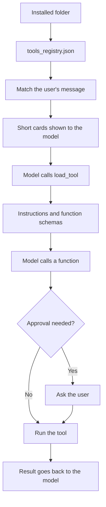

# Engine integration

This page explains what the Engine does with an installed tool. The Engine's own CEP reference is in the `cluaiz` repository under `docs/api/cep/`.

## The path of one tool



## Matching: which tools are offered

Nothing is put in the prompt in full unless the model asks for it. For each message the Engine scores the switched-on tools and shows up to 3 short cards and 5 titles. It matches whole words in any language, without word lists.

It matches against these fields:

| Source | Skill | Plugin | MCP server |
|---|---|---|---|
| `id` and `name` | Yes | Yes | Yes |
| `title` and `description` | Yes | Yes | Yes |
| Function names and descriptions | From `functions` | From `functions` | After the server's first start |
| `SKILL.md` frontmatter `triggers` | **Yes** | **No** | No |
| `package.json` `triggers.semantic` and `tags` | **Yes** | **No** | **No** |
| `package.json` `triggers` as a plain list | No | **Yes** | **Yes** |
| `package.json` `discovery.semantic_triggers` | No | **Yes** | **Yes** |

**For plugins and MCP servers, put trigger words in `package.json`.** When a plugin has a `package.json`, the Engine does not read the triggers in its `SKILL.md`, so words listed only there do not help the model find it:

```json
"triggers": ["calculate", "solve equation", "trigonometry"]
```

Good descriptions matter as much: say what the tool does and when to use it, in the words a user would type.

## Loading: what the model can ask for

| Function | Purpose |
|---|---|
| `find_tools` | Search installed tools, and get cards |
| `load_tool` | Get a tool's `SKILL.md` body and up to 6 of its functions in full; the others are named |
| `read_tool_file` | Read one more text file of the tool, such as `references/guide.md` |
| `unload_tool` | Remove a loaded tool from the chat |

The Engine answers these itself, without approval. A tool that goes unused for 3 answers is unloaded, or after `default_turns` when that is above 0.

The App or a caller can also bind a tool to a chat. A bound tool is in the system prompt in full.

## Calling: what happens to each type

The model's function name is matched to its tool, then the Engine dispatches:

| Order | Condition | What runs |
|---|---|---|
| 1 | Skill or plugin with `execution` in `package.json` | The script command |
| 2 | MCP server | `tools/call` to the running server, starting it if needed |
| 3 | Skill | Returns its `SKILL.md` |
| 4 | Plugin | The first program found in its folder |

### WebAssembly plugins

The function's arguments go in as JSON text, and the plugin's output goes back. **The function name is not passed to the program**, so a plugin with several functions must tell them apart by its arguments. The `text` plugin does this with an `action` field. See [WebAssembly interface](../plugins/wasm-abi-guide.md).

| Limit | Value |
|---|---|
| Instructions per call | 2,000,000,000 |
| Memory per call | 256 MB |
| Host functions | `cluaiz.now_utc_ms`, `cluaiz.utc_offset_minutes`, `cluaiz.os_platform`, `cluaiz.http_fetch` |
| Network | Public https addresses, with `permissions.network_access`. See [Network access](../plugins/wasm-abi-guide.md#network-access) |
| Files, other programs | None |

### Script plugins

The arguments are written to a temporary file in `<workspace>/<scratch_dir>/`. The command runs in the workspace with `{file}`, `{tool_dir}` and `{bin}` replaced. `{python}` becomes the command that runs Python on this system. The default timeout is 30 seconds, and a timeout also ends what the command started. The answer is a JSON object with the exit code, output and errors. See [Build types](../plugins/build-types.md#script-plugins).

### MCP servers

| Behaviour | Value |
|---|---|
| Start | On first use, not at Engine start |
| Working folder | The open workspace, also reported as its MCP root |
| Protocol version offered | `2025-06-18` |
| Used | `tools/list`, `tools/call`, `roots/list`, tool list changes, tool annotations |
| Not used | Resources, prompts, sampling |
| Transport | Standard input and output |
| Idle | Stopped after a period without use |
| Crash | Restarted with increasing delays, then marked unavailable |

## Approval

Security settings belong to each tool and to the Engine:

| Setting | Values |
|---|---|
| Engine mode | `full_access`, `sandboxed`, `strict` |
| Tool `security_mode` | `inherit`, `require_approval`, `always_allow` |
| Tool `execution_mode` | `auto`, `manual`, `confirm_destructive` |

In `sandboxed` mode with `inherit`, approval is needed for an MCP server, for `manual` or `confirm_destructive` tools, for tools declaring no permissions, and for tools with a sensitive permission such as network, write or execute.

A manifest cannot grant itself trust: `always_allow` in a manifest is reduced to `require_approval`. Only the user can give it.

The terminal agent does not start or offer a tool that nobody could approve, such as when it runs without a terminal. It reports how many it left out.

## Managing tools through CEP

Programs manage tools with these methods. Each takes a JSON-RPC request at `POST /v1/cep`.

| Method | Purpose |
|---|---|
| `tools.list` | Installed tools with their functions |
| `tools.discover` | What the matcher would offer for a message |
| `tools.install`, `tools.remove` | Install or remove |
| `tools.get_settings`, `tools.set_settings` | On or off, security mode, execution mode, trust, and the values a tool asks the user for, such as API keys (`user_settings`; values are never returned) |
| `tools.files`, `tools.read_file`, `tools.write_file`, `tools.open_file` | A tool's own files |
| `tools.cache`, `tools.clear_cache` | Cached downloads |
| `tools.call` | Run a tool directly, with `kind`, `name`, `fn`, `input` |

```json
{
  "jsonrpc": "2.0",
  "id": 1,
  "method": "tools.call",
  "params": {
    "kind": "plugin",
    "name": "math",
    "fn": "math_evaluate",
    "input": { "expression": "17 * 23" }
  }
}
```

## Cluaiz as an MCP server

Separately from the above, the Engine can itself be an MCP server for clients such as Claude Desktop and Cursor, through `POST /mcp` and `cluaiz mcp-server`. This exposes read-only Engine methods. It has nothing to do with the MCP servers Cluaiz runs.

## Fields the Engine does not read

These appear in manifests but have no effect in the Engine today. [Package specification](../package-spec.md) marks them.

- `dependencies` for tools (only npm-style text versions are used, to prepare a runtime)
- `permissions.max_cpu_time_ms`
- `allowed-tools` in `SKILL.md`: parsed, and neither approves nor limits anything
- `versions.<v>.files.binary`
