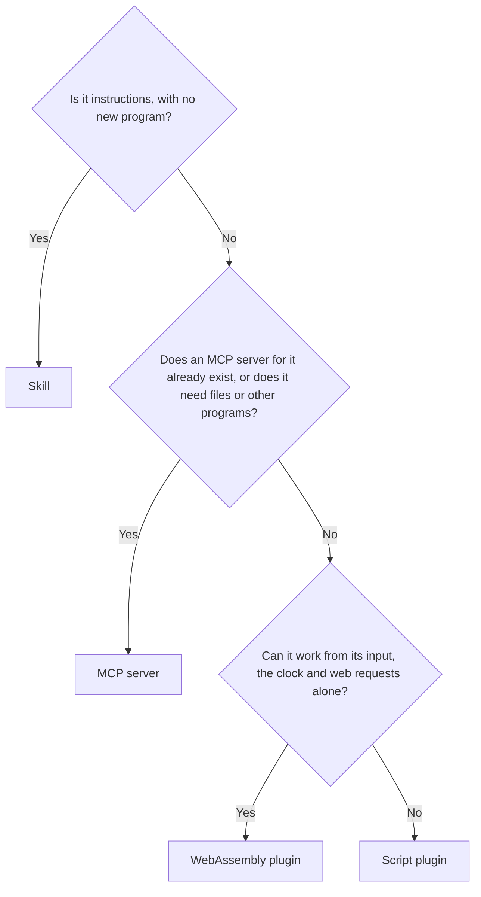

# Skills, Plugins, MCP and Extensions

Every tool in Cluaiz is one of four types. This page is the owner of what each type means.

## The types

### Skill: what the model knows

A skill is instructions in a `SKILL.md` file. The model loads it when it needs it, then follows it, often by using other tools.

- Format: the open [Agent Skills](https://agentskills.io/specification) format, so a skill can also work in other agents.
- No program is needed. Scripts and reference files are optional.
- Use it for procedures: reviewing code, a release checklist, a writing style.

### Plugin: what the Engine runs for the model

A plugin is a program that the Engine runs when the model calls one of its functions. It exists so that a tool works immediately after install, with nothing else on the user's machine.

| Kind | Needs on the user's machine | Boundary | Status |
|---|---|---|---|
| **WebAssembly** (`build_type: "wasm"`) | Nothing | Closed in: no files or other programs; the time always, and the internet only through the Engine with the user's permission | **Works** |
| **Script** (`execution` in `package.json`, no build) | The language the command names, such as Python | The user's rights, Engine timeout | **Works** |
| **Native binary** (`build_type: "binary"`) | Nothing | None | **Planned**: the Engine cannot run these yet |

A WebAssembly file is one file for every operating system and starts inside the Engine, so it needs no Node, Python or separate process. Its limit today is that it cannot read files or start programs. [CEP and plugins](../tutorials/plugins/03-cep-architecture.md) describes the planned way to give it more.

[Build types](../plugins/build-types.md) explains when each kind is right.

The word differs elsewhere. In Claude Code and Codex, a "plugin" is a package holding skills and MCP servers. In Cluaiz, a plugin is a program that runs.

### MCP server: what connects to the outside

An MCP server is a separate program that speaks the open [Model Context Protocol](https://modelcontextprotocol.io). Cluaiz starts it, lists its tools and calls them.

- Existing servers work without changes. A small `package.json` describes how to start them.
- It usually needs Node (`npx`) or Python (`uvx`) on the user's machine.
- Use it for databases, Git, services and anything that already has a server.
- Local servers over standard input and output **work**. Remote servers over HTTP are **Planned**.

### Extension: an App mini-application

**Experimental.** An extension may combine a user interface, a background worker and bundled tools. The Engine does not install or run extensions. Nothing else in these docs depends on them.

## Side by side

| | Skill | Plugin (WebAssembly) | MCP server |
|---|---|---|---|
| Main file | `SKILL.md` | `<id>.wasm` | Started from `execution` |
| Build step | None | Yes, by CI | None in this repository |
| Needed by the user | Nothing | Nothing | Usually Node or Python |
| Works in other agents | Yes | No | Yes |
| Reaches files or network | Only through other tools | The internet with the `network` permission; no files | Yes, as a normal program |
| Permissions enforced by | Not needed | The Engine | Asking before each call while one is refused |
| Published with | `package.json` | `package.json` | `package.json` |

## Which one to build

## How they work together

Tools do not call each other directly. The model connects them:

1. A skill tells the model which tool to use and when.
2. The model calls the tool.
3. The Engine runs it, asks for approval if needed, and gives the model the result.

A tool records what it needs under `dependencies`, each with `need` (`required`, `recommended` or `optional`) and `info`. Installing the tool installs or offers them by the user's mode (version ranges are not checked yet). See [Dependencies](../package-spec.md#dependencies).

| Caller | Can use | How |
|---|---|---|
| Model | Skills, plugins, MCP servers | Standard tool calls |
| App, CLI, scripts | The Engine and its tools | CEP, such as `tools.call` |
| Skill | Other tools | By instructing the model |
| WebAssembly plugin | The time, the operating system name, and the internet | Host functions; the internet with the user's permission |
| MCP server | Nothing in the Engine yet | **Planned** |
