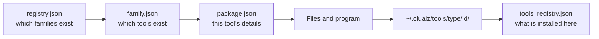

# Registry and discovery

This page follows a tool from the published registry to the Engine's list of installed tools. File formats are in [Registry files](../reference/tools-registry.md).

## The chain



| File | Lives | Answers |
|---|---|---|
| `registry.json` | Repository root | Where is each family? |
| `family.json` | `skills/`, `plugins/`, `mcp/`, `extensions/` | Which tools does this family have, and where is each one? |
| `package.json` | Each tool's folder or its own repository | What is this tool and what do I download? |
| `tools_registry.json` | The user's `~/.cluaiz/config/` | What is installed, and how is it set? |

The first three are published. The last is local and written by the Engine. It is not the same file as `registry.json`.

## Installing

`cluaiz plugin install math` or the CEP method `tools.install`:

1. Read `registry.json` and find `routing.plugins`. The default address is `https://raw.githubusercontent.com/cluaiz/cluaiz-tools/main/registry.json`.
2. Read `plugins/family.json` and find `items.math`.
3. Read `plugins/math/package.json`. Use `latest_version`, or the version asked for with `math@1.0.1`, which must be listed under `versions`.
4. Download what the type needs. See below.
5. Put it in a staging folder and check it, then swap it into `~/.cluaiz/tools/plugins/math/`. A failed install leaves the previous version in place.
6. Scan the tools folders and update `tools_registry.json`.

**The family key is the tool's id.** The key, the folder name and `id` in `package.json` must be the same. Release addresses and the installed folder are built from it.

### What gets downloaded

| Type | Files | Program |
|---|---|---|
| Skill, MCP | `versions.<v>.files.file_directory`, else the release `<type>-<id>-v<v>/<id>-files.zip` | None |
| Plugin `wasm` | Same as above | Required: `plugin-<id>-v<v>/<id>_v<v>.wasm`, saved as `<id>.wasm` |
| Plugin `binary` | Same as above | `versions.<v>.os.<system>`, saved as `<id>.dll`, `.dylib` or `.so`. **The Engine cannot run these yet** |
| Plugin with `execution` | Same as above | None. The command uses files from the bundle |

When a skill or MCP server has no release (HTTP 404), the Engine writes `package.json` and fetches each path listed in `versions.<v>.files` from the same folder as the manifest. That folder is on the `main` branch, so a requested older version gets its current files.

A plugin has no such fallback: it needs its release. A plugin with no program it can run is refused and nothing is installed.

Downloads are not checked against a hash today.

## Scanning

The Engine rebuilds its view from the folders. An installed tool is any folder in `tools/skills`, `tools/plugins` or `tools/mcp`:

- A listed tool whose folder was removed is dropped from `tools_registry.json`.
- A new folder is added, so a folder copied by hand works too. This is the simple way to test locally.
- Name, version, description and triggers are refreshed from the tool's files.
- User choices such as on or off and security mode stay.

## Local and remote entries

A family entry can point at this repository or at another one.

```json
{
  "category": "plugins",
  "name": "Cluaiz Plugins",
  "items": {
    "math": { "type": "local", "path": "math/package.json" },
    "image-optimizer": {
      "type": "remote",
      "repo": "your-name/your-plugin",
      "branch": "main",
      "manifest_path": "package.json"
    }
  }
}
```

| Entry | Status |
|---|---|
| `"math": "math/package.json"` (short form) | **Works** |
| `{ "type": "local", "path": "..." }` | **Works** |
| `{ "type": "remote", ... }` | **Planned**: today the Engine answers "not found" |

[Tools from other repositories](decoupled-ecosystem.md) explains how remote entries work.

## From installed to offered

Installing does not put anything in the model's prompt. [Engine integration](engine-integration.md) explains how installed tools are matched and loaded.
