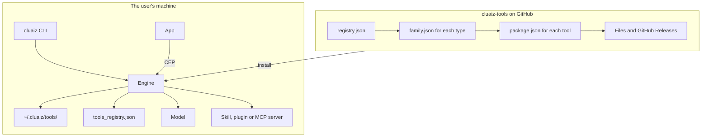

# System overview

Three repositories work together.

| Repository | What it is | What it does for tools |
|---|---|---|
| `cluaiz` | The Engine and the `cluaiz` command | Installs tools, shows them to the model, runs them, asks for approval |
| `cluaiz-tools` | This repository: the registry and the official tools | Lists what can be installed and holds official source files |
| `cluaiz-app` | The desktop App | Shows tools and talks to the Engine through CEP |



## The tool types

| Type | In one line | Runs where |
|---|---|---|
| **Skill** | Instructions the model reads when it needs them | In the model's context |
| **Plugin** | A program the Engine runs for the model | WebAssembly inside the Engine, or a script through the Engine |
| **MCP server** | An outside program that speaks the Model Context Protocol | Its own process |
| **Extension** | An App mini-application. Experimental | Not run by the Engine |

[Skills, Plugins, MCP and Extensions](plugin_vs_mcp_vs_extension_vs_skill.md) explains them and how to choose.

## Three connections

They are easy to mix up, so they have separate pages.

1. **Publishing to installing.** The Engine follows `registry.json`, `family.json` and `package.json`, then downloads files. See [Registry and discovery](registry-and-discovery.md).
2. **Model to Engine.** The model asks for a tool with a standard tool call. See [Turn lifecycle](turn-lifecycle.md).
3. **Programs to Engine.** The App, the scripts and other programs use CEP (`POST /v1/cep`, JSON-RPC 2.0). See [From CEL to CEP](cel-to-cep.md).

## On disk

```
~/.cluaiz/
├── config/tools_registry.json   What is installed and how it is set
└── tools/
    ├── skills/<id>/
    ├── plugins/<id>/
    └── mcp/<id>/
```

`CLUAIZ_HOME` moves this folder, which keeps tests away from a real installation.

A project can also have its own skills in `.agents/skills/`. The terminal agent reads those and `~/.agents/skills/`.

## Safety boundaries

| Type | Boundary today |
|---|---|
| Skill | Text only. It runs nothing by itself. A skill with `execution` runs scripts as a plugin does |
| WebAssembly plugin | No files, network or other programs. Instruction and memory limits. **Works** |
| Script plugin | Runs as a command with the user's rights, under the Engine's security mode and timeout |
| MCP server | A process with the user's rights. Calls ask for approval under the security mode |

The Engine enforces approval, so the result is the same from the CLI, the App and the API.
