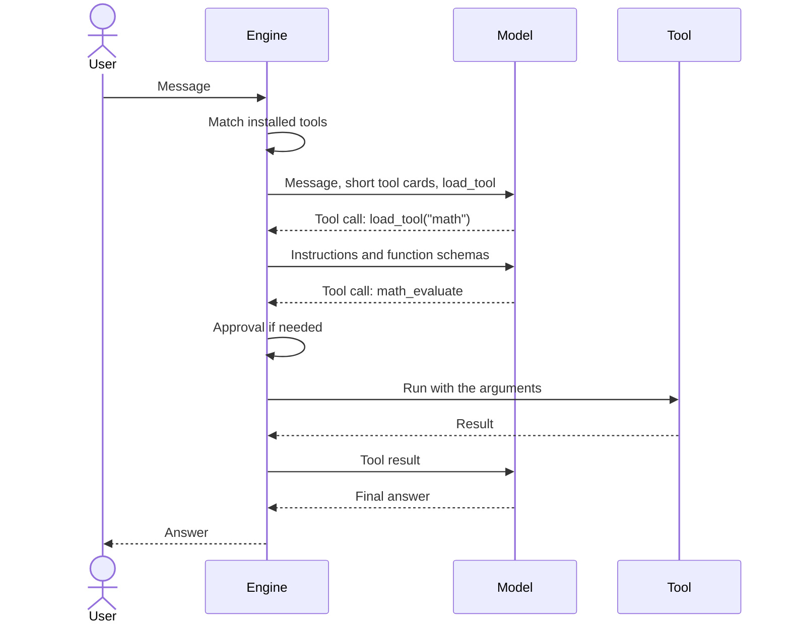

# Turn lifecycle

One turn is one user message and everything the model does to answer it, including tool calls. The terminal agent and the API share the same turn logic in the Engine.

## A turn with a tool

Each step after a tool call is a new round of generation with the result added to the context. The Engine reuses its KV cache for the unchanged part of the prompt, so the whole prompt is not processed again.

## Tool calls

The model writes a tool call in the form its chat template uses, and the Engine turns that into one internal form. The API returns standard `tool_calls`, as OpenAI-compatible clients expect.

A `<TRIGGER:...>` tag or a CEL statement means nothing to the Engine. See [From CEL to CEP](cel-to-cep.md).

## How long a tool stays

| Kind | Stays |
|---|---|
| Loaded with `load_tool` | Until the model unloads it, or after 3 answers that did not use it, or after `default_turns` when that is above 0 |
| Bound to the chat by the caller | For the set number of turns; `-1` means until removed |

Earlier load results of an unloaded tool become short notes in the conversation, which keeps the context small.

## Stopping

A turn stops when the model answers without a tool call, when it reaches a limit, or when the user cancels. A rejected approval goes back to the model as a tool result, so it can try another way.
