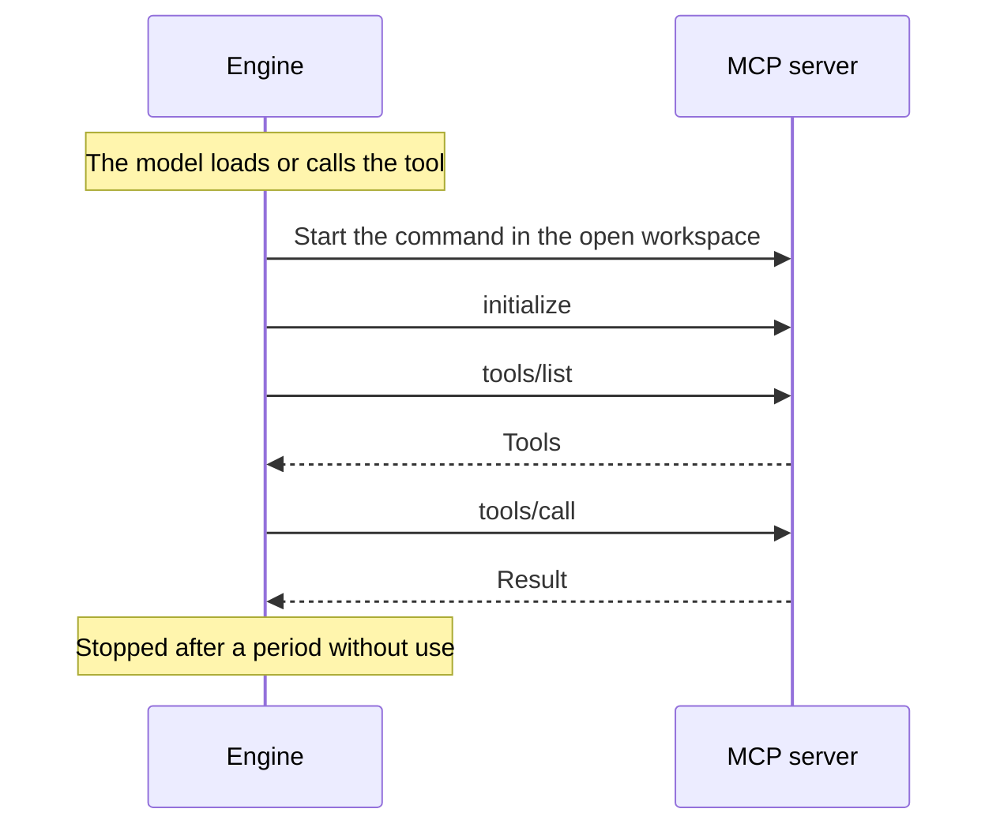

# MCP servers

The [Model Context Protocol](https://modelcontextprotocol.io) is the open standard for connecting AI to outside tools. An MCP server is a separate program that offers tools. Cluaiz starts it, lists its tools and calls them.

An MCP package in this repository holds no server code. It is a `package.json` that says how to start a server published elsewhere, such as on npm or PyPI.

## What works

| Feature | Status |
|---|---|
| Local servers over standard input and output | **Works** |
| `tools/list` and `tools/call` | **Works** |
| Tool list changes and tool annotations | **Works** |
| Roots: the server is told the open workspace | **Works** |
| Remote servers over Streamable HTTP | **Planned** |
| Resources and prompts | Not used |
| Sampling: a server asking the model for text | **Planned** |
| A newer protocol version than `2025-06-18` | **Planned** |

## How it runs



- A server starts on first use, so an installed server costs nothing until then.
- Its tool list is cached after the first start, and the matcher then uses it.
- The user needs whatever the command needs, usually Node for `npx` or `uv` for `uvx`. Say so in the description.
- A call asks for approval under the security mode. A user can trust a server's read-only marks, with `trust_annotations`.
- A server is a normal program, so the Engine cannot block what it reaches. It declares its permissions in `permissions`, and while the user refuses one, the Engine asks before each call.
- Settings and keys the user gives are named in `env`. The server gets each as an environment variable, from the system environment or from `cluaiz mcp config <id> <NAME>`.

## What is in a package

```
mcp/git/
├── package.json        Required: how to start it, permissions, settings, dependencies
├── README.md           Required: for people, with a Mermaid diagram
├── SKILL.md            Required: short guidance for the model
└── assets/icon.svg     Required
```

## Where to go next

- [MCP server package.json](package-json.md): a complete, real manifest, field by field
- [Package fields](manifest-schema.md)
- [Tutorial: connect a server](tutorial-connect-mcp.md)
- [Engine integration](../architecture/engine-integration.md#mcp-servers)
