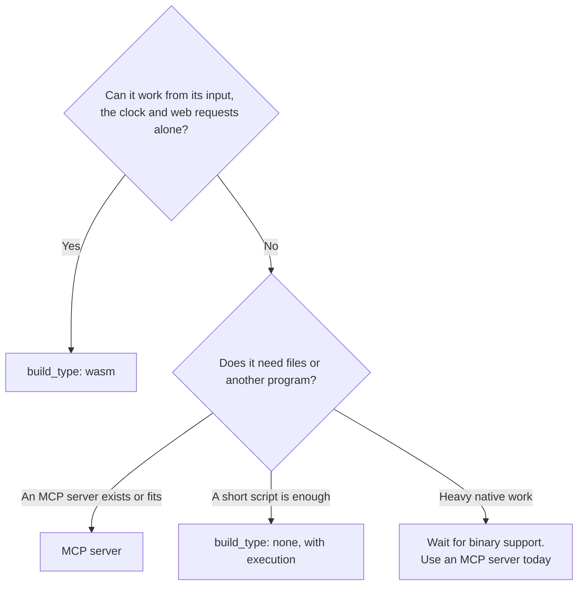

# Build types

This page answers three questions: when does a plugin become a WebAssembly file, when does it become a native binary, and when is nothing built at all?

## At a glance

| `build_type` | What the author writes | What CI makes | What the user gets | Status |
|---|---|---|---|---|
| `wasm` | Rust or C source | `<id>_v<version>.wasm` | `<id>.wasm` | **Works** |
| `none` with `execution` | Scripts | Only the zip | The scripts | **Works** |
| `binary` | Native source | One file per system | `<id>.dll`, `.dylib` or `.so` | **Planned** |

Skills and MCP servers never have a compile step. CI makes only their zip, or nothing is needed at all.

## How to choose



## WebAssembly (`wasm`)

**Choose it when** the job is exact computation on its input, such as math, parsing, hashing or text changes, or when it needs web requests and nothing else on the machine.

| | |
|---|---|
| Source | Rust with `crate-type = ["cdylib"]`, or anything that compiles to the interface |
| Built by | CI, with `--target wasm32-unknown-unknown` |
| Runs on | Every system, from one file |
| Needs on the machine | Nothing |
| Can reach | The date, time, time zone offset and system name, always; public https addresses with the `network` permission ([Permissions](../reference/permissions.md)) |
| Commit | Source only. Do not commit a compiled file |

The program name after install is always `<id>.wasm`. Older pages mention `logic.wasm`, which is not used.

## Script plugins

**Choose it when** a script does the job and a runtime such as Python is acceptable. Nothing is compiled, and the files are used as they are.

```json
{
  "id": "csv-tools",
  "hub_type": "plugin",
  "build_type": "none",
  "functions": [
    {
      "name": "csv_summary",
      "description": "Summarise a CSV file.",
      "parameters": {
        "type": "object",
        "properties": { "path": { "type": "string" } },
        "required": ["path"]
      }
    }
  ],
  "execution": {
    "type": "script_runner",
    "command": "{python} \"{tool_dir}/scripts/summary.py\" \"{file}\""
  },
  "dependencies": { "plugins": {}, "mcp": {}, "skills": {} },
  "permissions": {
    "files": { "info": "Reads the CSV file it is given", "allow": true, "can": ["read"], "where": "workspace" }
  },
  "latest_version": "1.0.0",
  "versions": {
    "1.0.0": {
      "updated_at": "2026-11-06T12:00:00Z",
      "files": { "scripts": ["scripts/summary.py"], "icon": "assets/icon.svg" }
    }
  }
}
```

The script reads its arguments as JSON from the file named by `{file}`, with the function's name in `_fn`, and prints its output. A setting it needs is named in `env` and reaches it as an environment variable. `{python}` becomes `python3` or `python`, whichever this system has.

| Behaviour | Value |
|---|---|
| Runs through | The system shell: PowerShell on Windows, `sh` elsewhere |
| Working folder | The open workspace |
| Temporary files | `<workspace>/<scratch_dir>/`, removed afterwards |
| Time limit | 30 seconds, or a `timeout` field in the input. It also ends what the script started |
| Answer | JSON: exit code, standard output, standard error |
| Rights | The user's. Not sandboxed: a refused permission makes the Engine ask before each call |

The runtime must be on the user's machine, so name it in the description and in `SKILL.md`.

Keep scripts in `scripts/`, because the release zip holds only `package.json`, `README.md`, `SKILL.md`, `scripts/`, `references/` and `assets/`. A plugin always installs from its release, so CI must have run for this version. A skill or MCP server can install without one.

**Use `execution`, not a bare script.** A `.py` or `.js` file in the plugin folder without `execution` is not a program to Windows, and fails with an error. On Linux and macOS it would need its executable bit and a first line naming its interpreter.

A plugin with `execution` always runs the script, even if a `.wasm` is also present.

## Native binary (`binary`)

**Status: Planned.** CI can build these, and the Engine downloads them, but **the Engine cannot run them**. A `.dll`, `.so` or `.dylib` is a library, and the Engine has nothing to load it with today. Do not publish a new binary plugin yet.

| Today | |
|---|---|
| CI output | `<id>_windows_x64.dll`, `lib<id>_linux_x64.so`, `lib<id>_macos_arm64.dylib` |
| Engine on install | Saves it as `<id>.dll`, `.so` or `.dylib`. Needs `versions.<v>.os` to find the right address |
| Engine on a call | Fails |

**The likely way forward** is a separate process, because loading a native library into the Engine would put it outside any sandbox and let a crash stop the Engine. This decision is open.

**Until then**, write heavy native work as an MCP server that users can start through `npx`, `uvx` or a program on their `PATH`.

## Files in the repository

| Commit this | Not this |
|---|---|
| `src/`, `Cargo.toml`, `Cargo.lock` | `target/` |
| `package.json`, `SKILL.md` | Compiled `.wasm`, `.dll`, `.so` |
| `assets/icon.svg`, `references/`, `scripts/` | Test output and data |

## Which plugin is which today

| Plugin | Type | Status |
|---|---|---|
| `math`, `text`, `rank` | `wasm`, no permissions | Runs |
| `time` | `wasm`, with `strict` network access | Runs |
| `web-search` | `wasm`, with `full` network access and keys in `env` | Runs |
| `code-interpreter`, `tool-creator` | Skill with `execution` | Runs |
