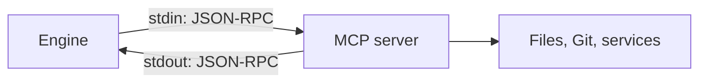

# 1. Connecting MCP servers

An MCP server is a separate program. The Engine starts it and talks to it over standard input and output with JSON-RPC.



## Describe it in `package.json`

`execution` says how to start the server. `permissions`, `env` and `dependencies` are the same as for any package; [MCP server package.json](../../mcp/package-json.md) explains each field.

```json
{
  "id": "context7",
  "name": "Context7 Docs",
  "category": "mcp",
  "hub_type": "mcp",
  "icon": "assets/icon.svg",
  "description": "Looks up current documentation for programming libraries. Needs Node and internet access. Use when an answer depends on how a library or framework works today.",
  "license": "MIT",
  "triggers": ["library documentation", "latest api docs", "context7"],
  "dependencies": { "plugins": {}, "mcp": {}, "skills": {} },
  "permissions": {
    "network": { "info": "Sends library names and questions to the Context7 service", "allow": true, "access": "strict", "hosts": ["context7.com"] }
  },
  "env": {
    "CONTEXT7_API_KEY": { "info": "A free Context7 key, for a higher rate limit", "need": "optional" }
  },
  "execution": {
    "command": "npx",
    "args": ["-y", "@upstash/context7-mcp@4.5.1"]
  },
  "latest_version": "1.0.0",
  "versions": {
    "1.0.0": {
      "updated_at": "2026-11-06T12:00:00Z",
      "files": { "readme": "README.md", "skill": "SKILL.md", "icon": "assets/icon.svg" }
    }
  }
}
```

## What to keep in mind

| Point | Detail |
|---|---|
| Runtime | The user needs Node for `npx` and `uv` for `uvx` |
| Working folder | The open workspace. Relative paths such as `.` mean that folder |
| Function list | Comes from the server. Do not write `functions` |
| `SKILL.md` | Required to publish. The model gets it when it loads the server |
| Permissions | The server is a normal program. While the user refuses one, the Engine asks before each call |
| Keys and settings | Name them in `env`; never publish a value. See [settings](02-fetching-settings.md) |

## Next

- [Tutorial: connect a server](../../mcp/tutorial-connect-mcp.md)
- [Package fields](../../mcp/manifest-schema.md)
- [Local testing](04-local-testing.md)
