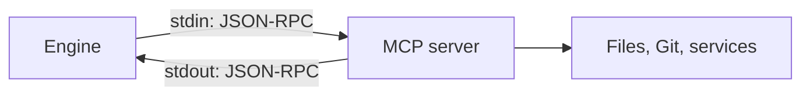

# 1. Connecting MCP servers

An MCP server is a separate program. The Engine starts it and talks to it over standard input and output with JSON-RPC.



## Describe it in `package.json`

Only `execution` is special. The rest is the same as any package.

```json
{
  "id": "github",
  "name": "GitHub",
  "category": "mcp",
  "hub_type": "mcp",
  "icon": "assets/icon.svg",
  "description": "Reads GitHub issues and pull requests. Needs Node.js.",
  "license": "MIT",
  "triggers": ["pull request", "github issue"],
  "execution": {
    "command": "npx",
    "args": ["-y", "@modelcontextprotocol/server-github"]
  },
  "latest_version": "1.0.0",
  "versions": {
    "1.0.0": {
      "updated_at": "2026-11-06T12:00:00Z",
      "files": { "icon": "assets/icon.svg" }
    }
  }
}
```

## What to keep in mind

| Point | Detail |
|---|---|
| Runtime | The user needs Node for `npx` and `uv` for `uvx` |
| Working folder | The open workspace. Relative paths such as `.` mean that folder |
| Function list | Comes from the server. Do not write `functions` |
| `SKILL.md` | Optional. The model gets it when it loads the server |
| Secrets | Do not publish them. See [settings](02-fetching-settings.md) |

## Next

- [Tutorial: connect a server](../../mcp/tutorial-connect-mcp.md)
- [Package fields](../../mcp/manifest-schema.md)
- [Local testing](04-local-testing.md)
