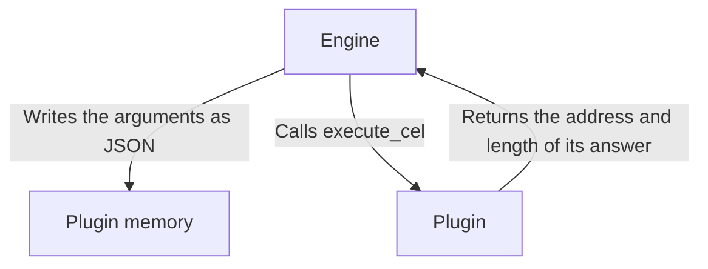

# 1. Building WebAssembly plugins

A WebAssembly plugin is one file that runs inside the Engine, on any system, with nothing else installed.



## The pieces

| Piece | Page |
|---|---|
| Exports the Engine needs: `allocate`, `execute_cel`, `memory` | [WebAssembly interface](../../plugins/wasm-abi-guide.md) |
| `package.json` with `build_type: "wasm"` and `functions` | [Package fields](../../plugins/manifest-schema.md) |
| Build target `wasm32-unknown-unknown` | [Build pipeline](../../architecture/build-pipeline.md#compiling-webassembly) |
| A full working example | [Tutorial: first plugin](../../plugins/tutorial-first-plugin.md) |

## Advice

- **Keep the logic in plain functions**, so `cargo test` can test them without WebAssembly.
- **Input and output are JSON.** Add `serde_json` for anything beyond a trivial plugin.
- **Avoid crates that need system access.** There is no WASI. A crate that reads files, the clock or random numbers through the system will fail to link or fail to start. Use the [host functions](../../plugins/wasm-abi-guide.md#host-functions) for time.
- **Build with size in mind.** The official plugins are between about 30 and 170 KB. Set this in `Cargo.toml`:

  ```toml
  [profile.release]
  opt-level = "s"
  lto = true
  ```

- **Return errors in your JSON**, with a message the model can act on.
