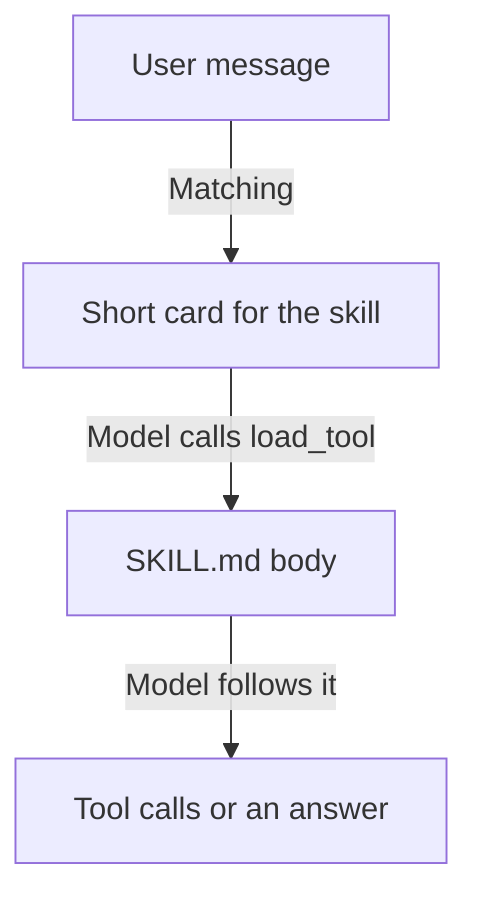

# 1. Creating skills

A skill is instructions for the model. It does not contain a program the Engine runs by default.



## Steps

1. **Pick one job.** "Research a topic and cite sources" is one job. "Help with everything" is not.
2. **Write the description.** Say what it does and when to use it. This is how it gets found.
3. **Write numbered steps.** Name the tools to use by their function names.
4. **Test by hand.** Put the folder in `.agents/skills/` and ask a real question.
5. **Add `package.json` and the icon** when you are ready to publish.

## Example

```markdown
---
name: research-assistant
description: Researches a topic and answers with sources. Use when the user asks to research or look something up.
license: Apache-2.0
---

# Research

1. Break the question into 2 or 3 search terms.
2. Call the search function for each term.
3. Answer using only what the results say, with a source for each claim.
4. If sources disagree, say so. Do not pick one silently.
```

A skill that depends on a tool lists it in `dependencies` in `package.json`, with `need` and `info`. The Engine installs or offers it by the user's mode, so the skill must still say what to do when a `recommended` or `optional` one is missing. See [Dependencies](../../package-spec.md#dependencies).

## Next

- [Authoring guide](../../skills/authoring-guide.md)
- [Tutorial: first skill](../../skills/tutorial-first-skill.md)
- [Package fields](../../skills/manifest-schema.md)
