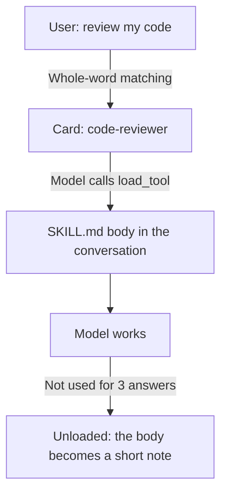

# 3. Skills and context

A large system prompt fills the context and slows each answer. Instead, the Engine shows short cards and the model loads a skill when it needs it.



## What this means for authors

**Write small skills, one for each job.** A large skill costs its full size every time it loads.

**Move detail to `references/`.** The model reads a file with `read_tool_file` only when it needs that file.

```markdown
For Rust code, also read `references/rust.md`.
```

**Say the load cost matters.** The card shows the model an estimate of a skill's size. A short skill is more likely to fit in a small context.

## What the Engine does and does not do

| Works | Not available |
|---|---|
| Cards and titles before loading | Embedding-based skill matching |
| Reusing the KV cache across rounds | Saved `state.kvcache.bin` files for a skill |
| Replacing old load results with notes | `vram_kv_inject` and `prefix_caching` in a manifest |

A large tool result is the other thing that fills context. A tool should return a short, structured result with the facts that matter, such as a file, line and message, not everything it read.
