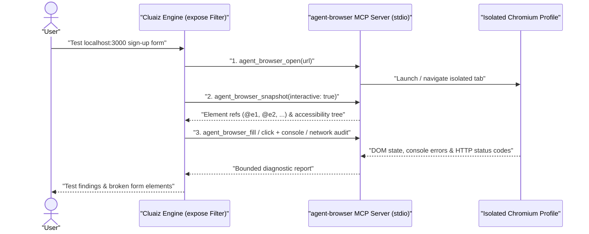

# Browser

Lets a model use a real Chromium browser through [agent-browser](https://github.com/vercel-labs/agent-browser): open pages, read them, click, type, and take screenshots. It also tests a website: script errors, console messages, failed requests, and an accessibility audit.

```text
Test the sign-up form on http://localhost:3000 and tell me what is broken.
```

## Technical Specification

- **Purpose:** Provides full browser automation, interactive DOM snapshots, console/network diagnostics, and accessibility auditing for JavaScript-rendered websites and local development servers.
- **Package Type:** MCP Server (`npx -y agent-browser@0.41.2 mcp --tools core,debug,network`)
- **Platform Support:** Tested on Windows; requires Node.js and a Chromium browser.
- **Security Boundary:** Runs in an isolated browser profile; `expose` in `package.json` restricts the model to 18 audited tools and blocks arbitrary page JavaScript evaluation (`eval`).

## System Architecture & Execution Flow



## What It Needs

- **Node**, for `npx`. It downloads `agent-browser` the first time.
- **A Chromium browser.** It finds an installed one, such as Chrome or Brave. If there is none, run `npx -y agent-browser@0.41.2 install` once, which downloads Chrome for Testing.

Firefox and Safari are not supported.

## What the Model Can Reach

The browser runs in its own window and profile, so the model does not get your logins. `expose` in `package.json` gives the model 18 of the server's tools. It cannot run JavaScript in a page, change certificate settings, or pass extra arguments, and the Engine refuses such a call.

The model can open any address the browser can, including local ones such as `http://localhost:3000`, so a website under development can be tested. Calls ask for approval unless you allow them.

## Settings

The browser runs without a window, and closes itself after 5 minutes without a call. There are two ways to see it:

- **For one task:** ask the model to show you, and it opens the browser with a window.
- **Always:**

```bash
cluaiz mcp config browser AGENT_BROWSER_HEADED 1
```

Set it to an empty value to hide the window again. A change applies when the server next starts.

Switching between hidden and visible restarts the browser, which loses the open page. The window shows what happens on the page, but no mouse pointer is drawn.

The browser belongs to the Cluaiz session: it closes when the session ends, for example when a one-off `cluaiz agent -p "..."` task finishes. To keep looking at a page, use `cluaiz agent` and keep the session open.

## Watching a Running Browser

To watch the browser at any time, including a hidden one, without restarting it:

```bash
npx -y agent-browser@0.41.2 dashboard
```

Then open the address it prints, which is `http://localhost:4848` by default. It shows the open page live, its address and tabs, and the commands that ran after you opened it, with console and network tabs. You can click on the page there. Stop it with `npx -y agent-browser@0.41.2 dashboard stop`.

If something else already uses that port, the command still prints the address but the dashboard does not start. Choose another port:

```bash
npx -y agent-browser@0.41.2 dashboard start --port 4857
```

## Installation & Status

```bash
cluaiz mcp install browser
```

Tested on Windows only.
