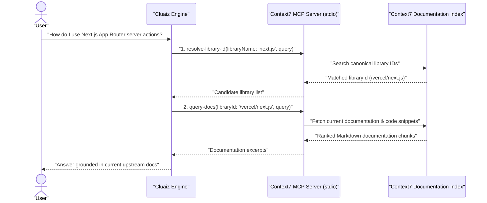

# Context7 Docs

Fetches current, version-accurate official documentation and code examples for programming libraries and frameworks through the Upstash Context7 Model Context Protocol server (`@upstash/context7-mcp`).

## Technical Specification

- **Purpose:** Prevents outdated API usage and deprecated SDK calls by resolving a library's canonical Context7 identifier and retrieving current documentation chunks at runtime.
- **Package Type:** MCP Server (`npx -y @upstash/context7-mcp@4.5.1`)
- **Platform Support:** Cross-platform (Windows, macOS, Linux)
- **Runtime Requirements:** Node.js (`npx`) and internet access.

## System Architecture & Execution Flow



## Exposed MCP Tools

| Tool Name | Required Inputs | Description |
|---|---|---|
| `resolve-library-id` | `libraryName`, `query` | Resolves a package or framework name (e.g., `"react"`, `"tokio"`, `"tailwind"`) into a Context7-compatible `libraryId`. |
| `query-docs` | `libraryId`, `query` | Queries the resolved library's documentation for specific API signatures, configuration guides, and code examples. |

## Failure & Recovery Logic

- **Unlisted Library:** If `resolve-library-id` returns no matching library, the model informs the user and can fall back to `web-search` if installed.
- **Network or Rate Limits:** If the upstream Context7 endpoint is unreachable, the server returns an MCP error response without hanging the Engine turn.

## Installation & Usage

```bash
cluaiz mcp install context7
```

Example prompt:

```text
Look up the latest Axum 0.8 router syntax using Context7 docs and show me how path parameters are written.
```

