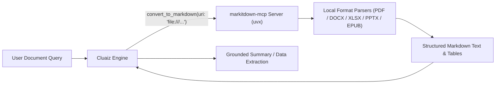

# Documents

Lets a model read PDF, Word (`.docx`), Excel (`.xlsx`), PowerPoint (`.pptx`), HTML, CSV, JSON, XML, EPUB, and ZIP files through Microsoft's [MarkItDown](https://github.com/microsoft/markitdown). The file is converted to Markdown text on this computer.

```text
Summarize invoice.pdf and list every amount in it.
```

## Technical Specification

- **Purpose:** Converts binary office documents, spreadsheets, presentations, and PDFs into structured Markdown on the local machine so models can read and cite their contents.
- **Package Type:** MCP Server (`uvx markitdown-mcp@0.0.1a8`)
- **Platform Support:** Tested on Windows; requires `uv` (`uvx`).
- **Security Mode:** `require_approval` (requests user confirmation before reading local files or remote URIs).

## System Architecture & Execution Flow



## Exposed MCP Tool

| Tool Name | Input Parameter | Supported URI Schemes |
|---|---|---|
| `convert_to_markdown` | `uri` (`string`) | `file:///absolute/path/to/file.pdf`, `http://...`, `https://...`, or `data:...` |

## What It Needs

- **uv**, for `uvx`. The first start downloads MarkItDown and its parts, about 150 MB, which takes a minute.

## What the Model Can Reach

The model passes a `file:`, `http:`, `https:`, or `data:` address. It can read any file your user account can, not only the open folder, so calls ask for approval unless you allow them.

Audio files are sent to an online speech service by MarkItDown, so the skill tells the model not to pass them (use the local `speech` skill for audio files instead).

## Permissions and dependencies

| Permission | At install | Info |
|---|---|---|
| Files (`files`): `read` in any folder | Not allowed, asked for (sensitive) | Reads the document files it is given, anywhere your account can read |
| Internet (`network`): full: any public host | Allowed | Reads web pages given as an http or https address |

While a permission is refused, the Engine asks before each call. The tool runs as a normal program, so the Engine cannot block that access itself.

Allow or refuse them with `cluaiz mcp permission documents [<permission> on|off]`, the App's tool page, or `tools.set_settings`. In `strict` mode every permission is asked for at install.

No dependencies.

## Installation & Status

```bash
cluaiz mcp install documents
```

Tested on Windows only.
