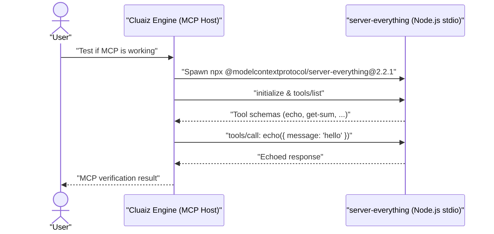

# Everything Test Server

Wraps the official Model Context Protocol reference test server (`@modelcontextprotocol/server-everything`) to verify that MCP process spawning, stdio JSON-RPC framing, and tool calls work properly on the host machine.

## Technical Specification

- **Purpose:** Provides deterministic diagnostic tools (`echo`, `get-sum`, etc.) to test and debug Cluaiz's MCP client pipeline without side effects.
- **Package Type:** MCP Server (`npx -y @modelcontextprotocol/server-everything@2.2.1`)
- **Platform Support:** Cross-platform (Windows, macOS, Linux)
- **Runtime Requirements:** Node.js (`npx`).

## System Architecture & Diagnostic Flow



## Diagnostic Tools Used

| Tool | Parameters | Expected Result |
|---|---|---|
| `echo` | `message` (`string`) | Returns the exact `message` string sent by the Engine. |
| `get-sum` | `a` (`number`), `b` (`number`) | Returns the sum of `a` and `b`. (For production math, use the `math` WebAssembly plugin.) |

## Failure & Recovery Logic

- **Node.js Missing:** If `npx` is not found on `PATH`, the Engine reports a process spawn error indicating Node.js is required.
- **First-Run Download Delay:** On the first invocation, `npx` downloads `@modelcontextprotocol/server-everything@2.2.1`, which may take a few seconds before `initialize` completes.

## Permissions and dependencies

No permissions declared.

Allow or refuse them with `cluaiz mcp permission everything [<permission> on|off]`, the App's tool page, or `tools.set_settings`. In `strict` mode every permission is asked for at install.

No dependencies.

## Installation & Usage

```bash
cluaiz mcp install everything
```

Example prompt:

```text
Run a check with the MCP test server to confirm MCP tools are working on my setup.
```

