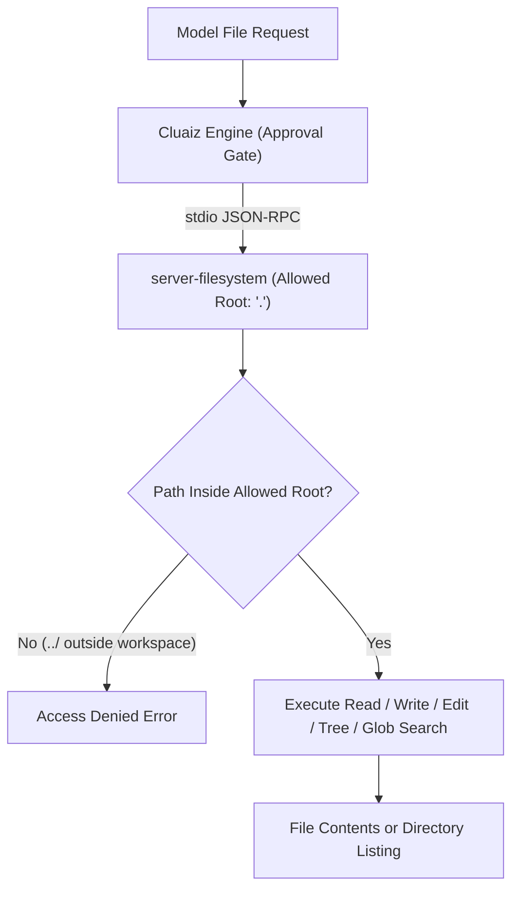

# Filesystem

Reads, writes, edits, moves, and searches files and directories strictly within the open workspace folder using the official Model Context Protocol filesystem server (`@modelcontextprotocol/server-filesystem`).

## Technical Specification

- **Purpose:** Provides workspace-scoped file and directory operations (`read_text_file`, `write_file`, `edit_file`, `list_directory`, `directory_tree`, `search_files`) over the standard MCP protocol.
- **Package Type:** MCP Server (`npx -y @modelcontextprotocol/server-filesystem@2.2.0 .`)
- **Platform Support:** Cross-platform (Windows, macOS, Linux)
- **Runtime Requirements:** Node.js (`npx`)
- **Security Boundary:** Rooted to `.` (the current open workspace folder); paths outside the allowed directory are rejected.

## System Architecture & Execution Flow



## Exposed MCP Tools

| Tool Name | Key Parameters | Purpose |
|---|---|---|
| `list_directory` | `path` | Lists immediate files and directories at `path`. |
| `directory_tree` | `path`, `depth` | Returns a nested JSON tree of the directory structure. |
| `search_files` | `path`, `pattern`, `excludePatterns` | Finds files matching a glob pattern (matches file names, not file contents). |
| `read_text_file` | `path`, optional `head` or `tail` | Reads a UTF-8 text file (or its first/last N lines for large files). |
| `read_multiple_files` | `paths` (`string[]`) | Reads several files in a single batch call. |
| `write_file` | `path`, `content` | Creates or overwrites a file with `content`. |
| `edit_file` | `path`, `edits` (`{oldText, newText}[]`), `dryRun` | Replaces exact text blocks and returns a unified diff preview when `dryRun: true`. |
| `create_directory` / `move_file` / `get_file_info` | `path` / `source`, `destination` | Creates directories, renames/moves files, or inspects file size and timestamps. |

## Failure & Recovery Logic

- **Workspace Escape Prevention:** Any path that resolves outside the workspace root (`.` passed at server startup) is refused by `@modelcontextprotocol/server-filesystem`.
- **Large File Handling:** Supports `head` and `tail` parameters on `read_text_file` so large logs can be inspected without loading the entire file into context.

## Installation & Usage

```bash
cluaiz mcp install filesystem
```

Example prompt:

```text
Show the directory tree of src/ up to depth 2 and read the first 40 lines of Cargo.toml.
```

