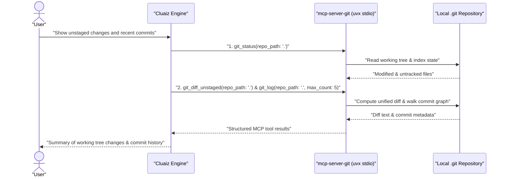

# Git

Inspects and manages local Git repositories—checking status, viewing unstaged/staged diffs, browsing commit history, creating branches, staging files, and committing changes—via the official `mcp-server-git` package.

## Technical Specification

- **Purpose:** Exposes structured Git repository operations over MCP so the model can inspect diffs, commit history, and branches without constructing raw shell pipelines.
- **Package Type:** MCP Server (`uvx mcp-server-git@2026.11.4`)
- **Platform Support:** Cross-platform (Windows, macOS, Linux)
- **Runtime Requirements:** `uv` (`uvx`) and `git` installed on the host.

## System Architecture & Execution Flow



## Exposed MCP Tools

Every tool call requires `repo_path` (pass `"."` for the current open workspace folder).

| Category | Tool Names | Description |
|---|---|---|
| **Repository State** | `git_status`, `git_branch`, `git_remote` | Shows working tree status, local/remote branches, and configured remotes. |
| **Diffs & Inspection** | `git_diff_unstaged`, `git_diff_staged`, `git_diff`, `git_show` | Displays unstaged changes, staged changes, diffs against a target ref, or a specific commit's patch. |
| **History** | `git_log` | Lists recent commits (`max_count`, optional date/author filters). |
| **Staging & Commits** | `git_add`, `git_reset`, `git_commit` | Stages specific file paths, unstages index entries, or records a new commit with a message. |
| **Branching** | `git_create_branch`, `git_checkout` | Creates a new branch or switches the working tree to an existing branch. |

## Failure & Recovery Logic

- **Non-Git Directory:** If `repo_path` does not contain a `.git` repository, `mcp-server-git` returns a clear error without modifying any files.
- **Approval Gate:** Mutating operations (`git_commit`, `git_checkout`, `git_reset`) are governed by the user's security mode (`require_approval`).

## Permissions and dependencies

| Permission | At install | Info |
|---|---|---|
| Files (`files`): `create`, `read`, `update`, `delete` in the workspace | Not allowed, asked for (sensitive) | Reads the repository, and stages, commits, branches and merges in it |

While a permission is refused, the Engine asks before each call. The tool runs as a normal program, so the Engine cannot block that access itself.

Allow or refuse them with `cluaiz mcp permission git [<permission> on|off]`, the App's tool page, or `tools.set_settings`. In `strict` mode every permission is asked for at install.

No dependencies.

## Installation & Usage

```bash
cluaiz mcp install git
```

Example prompt:

```text
Show me the unstaged diff in this repository and the last 5 commits on the current branch.
```

