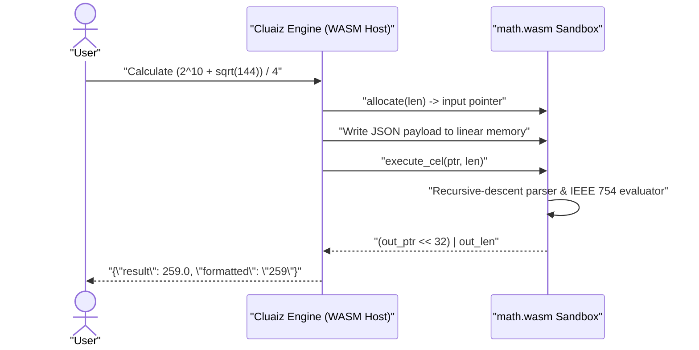

# Math

Evaluates mathematical expressions inside a sandboxed WebAssembly module, supporting arithmetic, exponents, roots, rounding, trigonometric functions, and logarithms with 64-bit IEEE 754 floating-point precision.

## Technical Specification

- **Purpose:** Replaces approximate token-prediction arithmetic with deterministic expression evaluation inside the Cluaiz WebAssembly runtime.
- **Package Type:** WebAssembly Plugin (`build_type: "wasm"`)
- **Platform Support:** Cross-platform (`wasm32-unknown-unknown` runs identically on Windows, macOS, and Linux)
- **Sandbox Permissions:** Zero network access (`network_access: false`), zero filesystem access (`file_system: "none"`), memory cap `16 MB`.

## System Architecture & Execution Flow



## API Contract

### Function: `math_evaluate`

| Parameter | Type | Required | Description |
|---|---|---|---|
| `expression` | `string` | Yes | Mathematical expression to evaluate (e.g., `"(2^10 + sqrt(144)) / 4"`). |
| `precision` | `integer` | No | Optional number of decimal places for the `formatted` string output. |

### Supported Operators & Functions

| Category | Syntax |
|---|---|
| **Arithmetic & Grouping** | `+`, `-`, `*`, `/`, `%` (modulo), `^` (power), `(`, `)` |
| **Constants** | `pi` (\(\pi\)), `e` (Euler's number) |
| **Roots & Rounding** | `sqrt(x)`, `cbrt(x)`, `abs(x)`, `floor(x)`, `ceil(x)`, `round(x)` |
| **Trigonometry (Radians)** | `sin(x)`, `cos(x)`, `tan(x)`, `asin(x)`, `acos(x)`, `atan(x)` |
| **Logarithms & Exponentials** | `ln(x)` (natural log), `log10(x)`, `log2(x)`, `exp(x)` |

## Failure & Recovery Logic

- **Ambiguous `log` Rejected:** Bare `log(x)` returns a clear validation error directing the caller to use `ln(x)` or `log10(x)` so the base is never ambiguous.
- **Division by Zero & Syntax Errors:** Returns `{"status": "error", "error": "..."}` without panicking or trapping the WebAssembly instance.

## Build & Installation

```bash
cluaiz plugin install math
```

To build and test from source:

```bash
cargo test
cargo build --release --target wasm32-unknown-unknown
```

