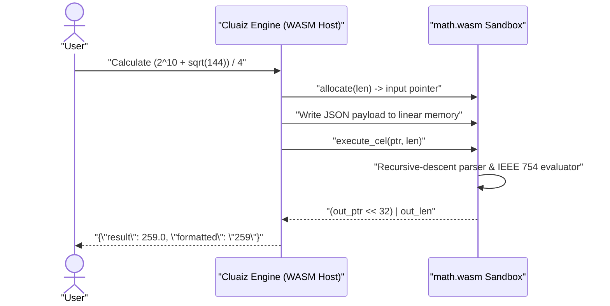

# Math

Evaluates mathematical expressions and converts units inside a sandboxed WebAssembly module: arithmetic, exponents, roots, rounding, trigonometry, logarithms in any base, factorials, combinations and permutations, minimum and maximum, with 64-bit IEEE 754 floating-point precision.

## Technical Specification

- **Purpose:** Replaces approximate token-prediction arithmetic with deterministic expression evaluation inside the Cluaiz WebAssembly runtime.
- **Package Type:** WebAssembly Plugin (`build_type: "wasm"`)
- **Platform Support:** Cross-platform (`wasm32-unknown-unknown` runs identically on Windows, macOS, and Linux)
- **Permissions:** see [Permissions and dependencies](#permissions-and-dependencies).

## System Architecture & Execution Flow



## API Contract

### Function: `math_evaluate`

| Parameter | Type | Required | Description |
|---|---|---|---|
| `expression` | `string` | Yes | Mathematical expression to evaluate (e.g., `"(2^10 + sqrt(144)) / 4"`). |
| `precision` | `integer` | No | Optional number of decimal places for the `formatted` string output. |

### Supported Operators & Functions

| Category | Syntax |
|---|---|
| **Arithmetic & Grouping** | `+`, `-`, `*`, `/`, `%` (modulo), `^` (power), `(`, `)` |
| **Constants** | `pi` (\(\pi\)), `e` (Euler's number) |
| **Roots & Rounding** | `sqrt(x)`, `cbrt(x)`, `abs(x)`, `floor(x)`, `ceil(x)`, `round(x)` |
| **Trigonometry (Radians)** | `sin(x)`, `cos(x)`, `tan(x)`, `asin(x)`, `acos(x)`, `atan(x)` |
| **Logarithms & Exponentials** | `ln(x)` (natural log), `log10(x)`, `log2(x)`, `log(x, base)`, `exp(x)` |
| **Counting** | `n!`, `factorial(n)`, `nCr(n, r)`, `nPr(n, r)`; whole numbers, up to `170!` |
| **Several values** | `min(a, b, ...)`, `max(a, b, ...)` |

### Function: `math_convert`

| Parameter | Type | Required | Description |
|---|---|---|---|
| `value` | `number` | Yes | The amount to convert. |
| `from` | `string` | Yes | The unit of the value, as a symbol or a name (`km`, `miles`, `°F`). |
| `to` | `string` | Yes | The unit to convert to. It must measure the same quantity. |
| `precision` | `integer` | No | Digits after the decimal point in `formatted`. |

Quantities: length, mass, time, area, volume, speed, data, energy, power, pressure, angle and temperature. Data units follow SI (`kB` = 1000 bytes) and IEC (`KiB` = 1024 bytes). Gallons, pints and cups are US units; `imp_gal` and `imp_pt` are imperial. A year is 365.25 days. Names are matched exactly first, then without case when only one unit fits, so `mb` is refused because it could mean `MB` or `Mb`.

## Failure & Recovery Logic

- **Ambiguous `log` Rejected:** Bare `log(x)` returns an error asking for `log(x, base)`, `ln(x)` or `log10(x)`, so the base is never guessed.
- **Units That Do Not Match:** Converting between quantities, such as kilograms to metres, or a temperature below absolute zero, returns an error.
- **Division by Zero & Syntax Errors:** Returns `{"status": "error", "error": "..."}` without panicking or trapping the WebAssembly instance.

## Permissions and dependencies

No permissions. It cannot reach the internet, files or other programs.

Allow or refuse them with `cluaiz plugin permission math [<permission> on|off]`, the App's tool page, or `tools.set_settings`. In `strict` mode every permission is asked for at install.

No dependencies.

## Build & Installation

```bash
cluaiz plugin install math
```

To build and test from source:

```bash
cargo test
cargo build --release --target wasm32-unknown-unknown
```

