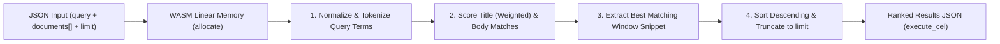

# Rank

Ranks an in-memory collection of text documents against a keyword query using term-frequency and title-weighted scoring inside a sandboxed WebAssembly module, returning the top matches with contextual snippets.

## Technical Specification

- **Purpose:** Provides deterministic, zero-dependency lexical ranking and snippet extraction over candidate documents already held in memory.
- **Package Type:** WebAssembly Plugin (`build_type: "wasm"`)
- **Platform Support:** Cross-platform (`wasm32-unknown-unknown`)
- **Sandbox Permissions:** Zero network access (`network_access: false`), zero filesystem access (`file_system: "none"`), memory cap `32 MB`.

## System Architecture & Execution Flow



## API Contract

### Function: `rank_documents`

| Parameter | Type | Required | Description |
|---|---|---|---|
| `query` | `string` | Yes | Search keywords to rank documents against. |
| `documents` | `array<object>` | Yes | List of document objects, each with `id`, optional `title`, and `content`. |
| `limit` | `integer` | No | Maximum number of ranked results to return (default `5`). |

### Example Payload

```json
{
  "query": "memory limit",
  "documents": [
    { "id": "doc-1", "title": "Plugins", "content": "Each WebAssembly plugin call runs under a strict memory limit." },
    { "id": "doc-2", "title": "Skills", "content": "Skills are Markdown instructions loaded on demand." }
  ],
  "limit": 3
}
```

## Failure & Recovery Logic

- **No Filesystem or Web Access by Design:** `rank` operates strictly on the `documents` array passed in the call. To read local files first, combine with the `filesystem` MCP server; to search the internet, use the `web-search` plugin.
- **Empty Query or Document List:** Returns a structured error message rather than trapping.

## Build & Installation

```bash
cluaiz plugin install rank
```

To build and test from source:

```bash
cargo test
cargo build --release --target wasm32-unknown-unknown
```

