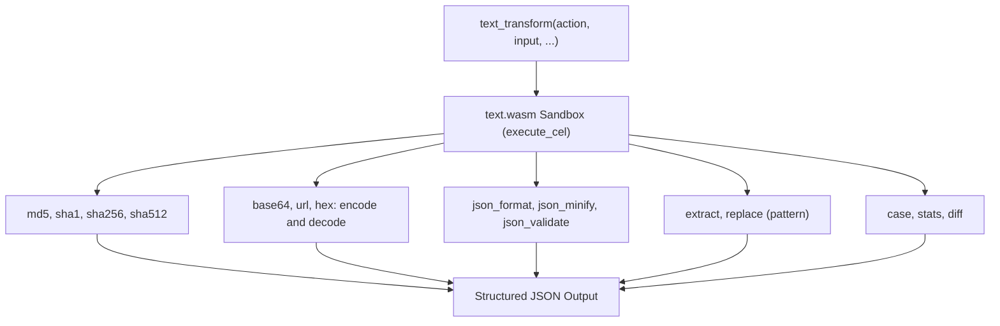

# Text

Performs exact text transformations and inspections inside a WebAssembly sandbox: MD5, SHA-1, SHA-256 and SHA-512 hashing; Base64, URL and hex encoding and decoding; JSON formatting, minifying and validation; regular expression extraction and replacement; case conversion; line-by-line diffing; and character/word/line/byte counting.

## Technical Specification

- **Purpose:** Prevents token-level errors when computing hashes, encoding binary/text payloads, matching regular expressions, or counting exact bytes and lines.
- **Package Type:** WebAssembly Plugin (`build_type: "wasm"`)
- **Platform Support:** Cross-platform (`wasm32-unknown-unknown`)
- **Permissions:** see [Permissions and dependencies](#permissions-and-dependencies).

## System Architecture & Execution Flow



## API Contract

### Function: `text_transform`

| `action` Value | Required Parameters | Returned Fields |
|---|---|---|
| `md5`, `sha1`, `sha256`, `sha512` | `input` | `result`: the lowercase hex digest of the UTF-8 bytes. |
| `base64_encode`, `base64_decode` | `input` | `result`. Decoding also accepts the URL-safe alphabet, line breaks and missing padding. |
| `url_encode`, `url_decode` | `input` | `result`. Encoding keeps only letters, digits and `-_.~` (RFC 3986). Decoding reads `+` as a space. |
| `hex_encode`, `hex_decode` | `input` | `result`. Decoding ignores spaces, colons and a leading `0x`. |
| `json_format`, `json_minify` | `input` | `result`: indented by two spaces, or on one line. Key order and number text are kept. |
| `json_validate` | `input` | `valid`: `true` or `false`, and `error` with the line and column. |
| `case` | `input`, `case` | `result`. `case` is `upper`, `lower`, `title`, `sentence`, `snake`, `kebab`, `camel`, `pascal` or `constant`. |
| `stats` | `input` | `stats`: `{ chars, words, lines, bytes }`. |
| `diff` | `input`, `target` | `diff_summary`: added/removed/unchanged line counts and a patch. |
| `extract` | `input`, `pattern` | `matches`: up to 1000 substrings matching the regular expression. |
| `replace` | `input`, `pattern`, `replacement` | `result`, and `replaced`: the number of matches. `$1` or `${name}` in `replacement` is a group. |

## Failure & Recovery Logic

- **Invalid Base64, Hex, URL Escapes, JSON or Regex Syntax:** Returns `{"status": "error", "error": "..."}` explaining the exact parse failure without crashing the plugin instance.
- **Missing Action-Specific Parameters:** If `extract` or `replace` is called without `pattern`, `replace` without `replacement`, or `case` without `case`, returns an error naming what is missing. Decoded bytes that are not UTF-8 text are an error that shows them in hex.

## Permissions and dependencies

No permissions. It cannot reach the internet, files or other programs.

Allow or refuse them with `cluaiz plugin permission text [<permission> on|off]`, the App's tool page, or `tools.set_settings`. In `strict` mode every permission is asked for at install.

No dependencies.

## Build & Installation

```bash
cluaiz plugin install text
```

To build and test from source:

```bash
cargo test
cargo build --release --target wasm32-unknown-unknown
```

