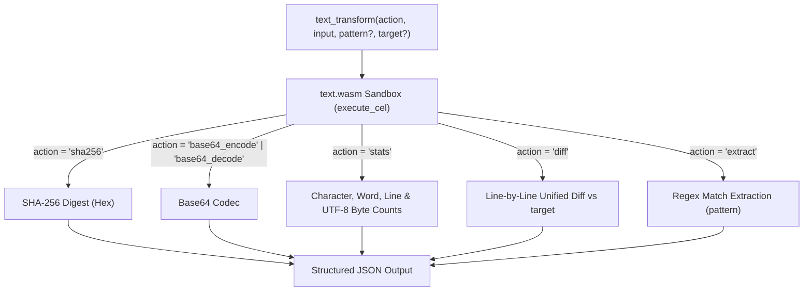

# Text

Performs exact text transformations and inspections inside a WebAssembly sandbox: SHA-256 cryptographic hashing, Base64 encoding and decoding, regular expression extraction, line-by-line diffing, and character/word/line/byte counting.

## Technical Specification

- **Purpose:** Prevents token-level errors when computing hashes, encoding binary/text payloads, matching regular expressions, or counting exact bytes and lines.
- **Package Type:** WebAssembly Plugin (`build_type: "wasm"`)
- **Platform Support:** Cross-platform (`wasm32-unknown-unknown`)
- **Sandbox Permissions:** Zero network access (`network_access: false`), zero filesystem access (`file_system: "none"`), memory cap `32 MB`.

## System Architecture & Execution Flow



## API Contract

### Function: `text_transform`

| `action` Value | Required Parameters | Returned Fields |
|---|---|---|
| `sha256` | `input` | `result`: 64-character lowercase hex SHA-256 digest. |
| `base64_encode` | `input` | `result`: standard Base64-encoded string. |
| `base64_decode` | `input` | `result`: decoded UTF-8 string (or error if invalid Base64). |
| `stats` | `input` | `stats`: `{ characters, words, lines, bytes }`. |
| `diff` | `input`, `target` | `diff_summary`: added/removed/unchanged line counts and unified diff patch. |
| `extract` | `input`, `pattern` | `matches`: array of all substrings matching the regular expression `pattern`. |

## Failure & Recovery Logic

- **Invalid Base64 or Regex Syntax:** Returns `{"status": "error", "error": "..."}` explaining the exact parse failure without crashing the plugin instance.
- **Missing Action-Specific Parameters:** If `diff` is called without `target` or `extract` is called without `pattern`, returns a descriptive parameter validation error.

## Build & Installation

```bash
cluaiz plugin install text
```

To build and test from source:

```bash
cargo test
cargo build --release --target wasm32-unknown-unknown
```

