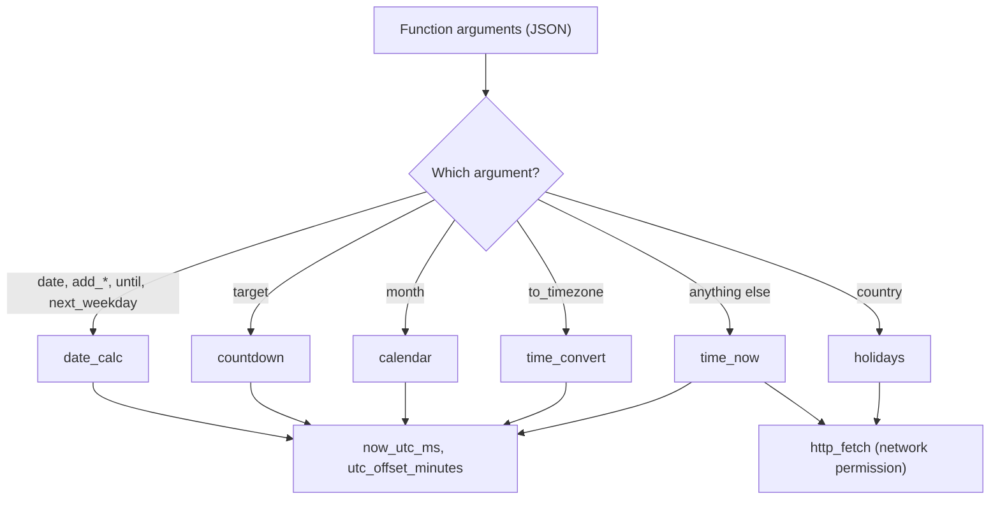

# Time

Gives models the real date and time and exact calendar work inside a WebAssembly sandbox: the time here or in any IANA time zone with daylight saving, conversion between zones, date arithmetic with working days, ages, ISO weeks and weekdays, month calendars, countdowns, a check of this computer's clock against the internet, and public holidays.

## Technical Specification

- **Purpose:** A model does not know the date, and guesses time zone offsets and day counts. This plugin reads them and computes them.
- **Package Type:** WebAssembly Plugin (`build_type: "wasm"`), built with `chrono` and `chrono-tz` (the IANA time zone database is embedded, so names and daylight saving rules need no network).
- **Platform Support:** Cross-platform (`wasm32-unknown-unknown`)
- **Permissions:** see [Permissions and dependencies](#permissions-and-dependencies).

## System Architecture & Execution Flow



The Engine passes a function's arguments, not its name, so each function has an argument only it uses.

## API Contract

| Function | Arguments | Answer |
|---|---|---|
| `time_now` | `timezone`, `check_clock` | `iso_8601`, `date`, `time`, `time_12h`, `day_of_week`, `utc_offset`, `utc`, `timestamp_ms`; for a named zone also `abbreviation`, `daylight_saving`, `region`, `place`; with `check_clock`, `clock_check` with `drift_ms`, `uncertainty_ms` and `verdict` |
| `time_convert` | `time`, `from_timezone`, `to_timezone` (list) | `from`, and `results` with each zone's time and `day_change`; `note` when the time happens twice |
| `date_calc` | `date`, `add_years`, `add_months`, `add_weeks`, `add_days`, `add_working_days`, `next_weekday`, `until`, `timezone` | The date with `day_of_week`, `iso_week`, `day_of_year`, `leap_year`; `result`; `next_weekday`; with `until`, `days_between`, `weeks_and_days`, `working_days_between` and `difference` (years, months, days) |
| `calendar` | `month`, `week_starts` | `calendar` (text grid), `days`, `working_days`, `first_day`, `last_day`, `today` |
| `countdown` | `target`, `timezone` | `days`, `hours`, `minutes`, `seconds`, `total_seconds`, `past`, `text` |
| `holidays` | `country`, `year` | `holidays` (date, weekday, name, local name, nationwide, regions, types), `count`, `next` |

## Failure & Recovery Logic

- **Unknown or Shared Zone Names:** `IST`, `CST` and other abbreviations are refused because several zones share them; a city found in two zone names asks for the full name.
- **Clock Changes:** A local time skipped when the clocks go forward is an error; a time that happens twice gives the first and a `note`.
- **Invalid Dates:** Non-existent dates (such as `2026-02-30`) are errors. Adding months keeps the day, or the month's last day when it is shorter.
- **Network Off or Unavailable:** `check_clock` and `holidays` pass on the Engine's answer, including the command to switch the permission on. A country the holiday service does not cover is an error that says so.
- **Not Possible Here:** Saving events, alarms and reminders. A WebAssembly plugin cannot write files or run later.

## Permissions and dependencies

| Permission | At install | Info |
|---|---|---|
| Internet (`network`): strict: only `www.cloudflare.com`, `date.nager.at` | Allowed | Only when asked: checks this computer's clock against an internet clock, and reads public holidays |

While a permission is refused, the Engine refuses that access: the function answers `permission_off` with the command that allows it.

Allow or refuse them with `cluaiz plugin permission time [<permission> on|off]`, the App's tool page, or `tools.set_settings`. In `strict` mode every permission is asked for at install.

No dependencies.

## Build & Installation

```bash
cluaiz plugin install time
```

To build and test from source:

```bash
cargo test
cargo build --release --target wasm32-unknown-unknown
```

