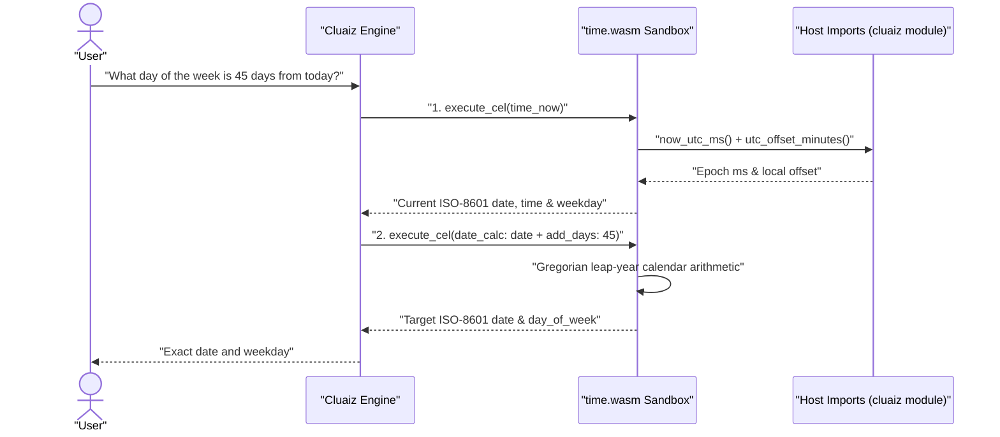

# Time

Reads the host computer's current system clock, UTC offset, and day of the week, and performs exact calendar arithmetic (adding/subtracting days or months, or counting days between two dates) inside a WebAssembly sandbox.

## Technical Specification

- **Purpose:** Gives local models an authoritative system clock and calendar calculator via Cluaiz WebAssembly host imports (`now_utc_ms`, `utc_offset_minutes`, `os_platform`) with zero network calls.
- **Package Type:** WebAssembly Plugin (`build_type: "wasm"`)
- **Platform Support:** Cross-platform (`wasm32-unknown-unknown`)
- **Sandbox Permissions:** Zero network access (`network_access: false`), zero filesystem access (`file_system: "none"`).

## System Architecture & Execution Flow



## API Contract

### 1. `time_now`

Returns the current local date, time, weekday, UTC timestamp, and operating system platform.

| Parameter | Type | Required | Description |
|---|---|---|---|
| `utc_offset` | `string` | No | Optional UTC offset such as `"+05:30"`, `"-04:00"`, or `"Z"` to view the current time in another offset. Named IANA zones (e.g. `"America/New_York"`) are not used; pass the numeric offset. |

### 2. `date_calc`

Computes a date offset by days/months or counts the exact days between two `YYYY-MM-DD` dates.

| Parameter | Type | Required | Description |
|---|---|---|---|
| `date` | `string` | Yes | Starting date in `"YYYY-MM-DD"` format. |
| `add_days` | `integer` | No | Number of days to add (positive) or subtract (negative). |
| `add_months` | `integer` | No | Number of calendar months to add or subtract (clamping month-end days, e.g., Jan 31 + 1 month -> Feb 28/29). |
| `until` | `string` | No | Second `"YYYY-MM-DD"` date to compute the exact day difference (`days_between`). |

## Failure & Recovery Logic

- **Invalid Calendar Dates:** Rejects non-existent dates (such as `"2026-02-29"` in a non-leap year) with an explicit validation error.
- **Malformed UTC Offset:** Validates `±HH:MM` bounds before applying custom offsets.

## Build & Installation

```bash
cluaiz plugin install time
```

To build and test from source:

```bash
cargo test
cargo build --release --target wasm32-unknown-unknown
```

