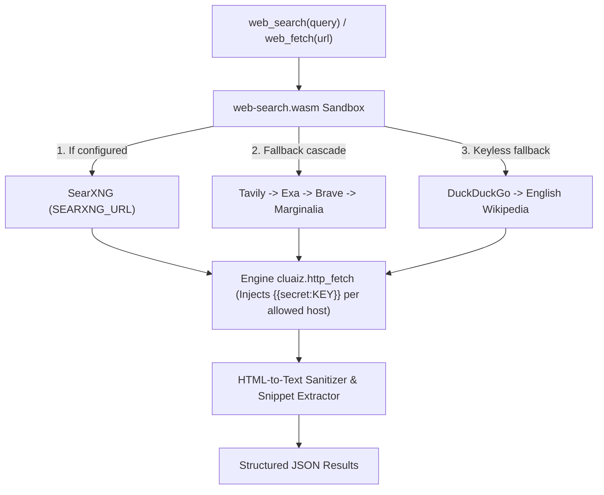

# Web Search

Searches the web and reads web pages as clean text from a single WebAssembly plugin. Works out of the box and supports user-configured search providers (`SearXNG`, `Tavily`, `Exa`, `Brave Search`, `Marginalia`, `DuckDuckGo`, and `Wikipedia`) through the Cluaiz Engine's secret-injected `http_fetch` bridge.

## Technical Specification

- **Purpose:** Gives local models live web search and page extraction inside a memory-safe WebAssembly sandbox without exposing API keys to the plugin or model context.
- **Package Type:** WebAssembly Plugin (`build_type: "wasm"`)
- **Platform Support:** Cross-platform (`wasm32-unknown-unknown`)
- **Host ABI Requirement:** Requires Cluaiz Engine `cluaiz.http_fetch` host import (`permissions.network_access: true`).

## System Architecture & Provider Cascade



## API Contract

| Function | Input | Result |
|---|---|---|
| `web_search` | `query`, optional `max_results` (1 to 10) | Titles, links, snippets, and the provider that answered |
| `web_fetch` | `url`, optional `max_chars` (up to 50000) | The page's title, description, and extracted body text |

## Search Providers

Providers are tried in this order. One that is not set up costs no request.

| Provider | Setting | Notes |
|---|---|---|
| Your own SearXNG | `SEARXNG_URL` | No limit of its own. The search engines behind it can still block your server. Turn on the `json` format in its `settings.yml` |
| Tavily | `TAVILY_API_KEY` | Has a free monthly allowance |
| Exa | `EXA_API_KEY` | Has a free monthly allowance |
| Brave Search | `BRAVE_API_KEY` | Monthly credit. Its site asks for a card |
| Marginalia | `MARGINALIA_API_KEY` | A small independent index. Check its licence for your use |
| DuckDuckGo | None | Best effort. It often answers automated requests with a challenge, which is reported as blocked and never worked around |
| Wikipedia | None | English Wikipedia only, and labelled as such in the answer |

Check each provider's terms and current prices on its own site.

If every provider fails, the answer says so and lists what was tried. Results are never made up. When only Wikipedia answered, or nothing did, the answer tells the model to search with the browser tool if it has one, and otherwise to ask the user whether to install it. The plugin never installs anything.

## Settings & Secret Isolation

Set them with one command. Leave out the value to be asked for it without it showing on screen:

```bash
cluaiz plugin config web-search TAVILY_API_KEY
cluaiz plugin config web-search SEARXNG_URL http://localhost:8080
```

They are kept in `config/tool_settings.json` in the Engine's data folder, not in the plugin's files.

An app sets them through the API, with the CEP method `tools.set_settings`:

```json
{"jsonrpc": "2.0", "id": 1, "method": "tools.set_settings",
 "params": {"kind": "plugin", "name": "web-search", "patch": {"user_settings": {"TAVILY_API_KEY": "tvly-..."}}}}
```

An empty string removes a value. `tools.get_settings` lists the settings a tool asks for, with `secret` and `set` for each, and never returns a value.

The plugin never sees a key. It asks for `{{secret:TAVILY_API_KEY}}` in a header, and the Engine fills in the value, only for the host named in `permissions.secrets` in `package.json`.

## What It Can Reach

Every request goes through the Engine, which allows only `https` to public addresses and checks each redirect again. A page is read up to 2 MB. `SEARXNG_URL` is the only address that may be local or plain `http`, because the user chose it.

## Build & Installation

```bash
cluaiz plugin install web-search
```

To build and test from source:

```bash
cargo build --release --target wasm32-unknown-unknown
cargo test
```

The tests run natively against a stand-in for the Engine.
