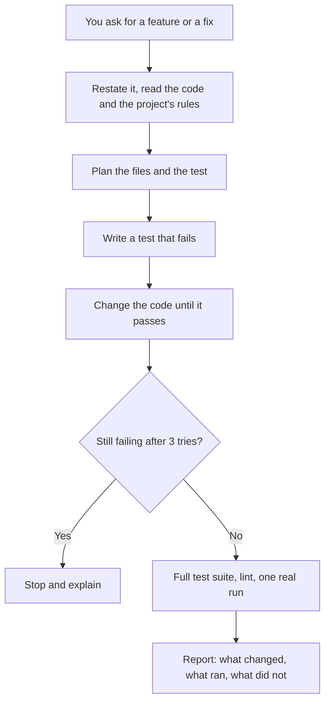

# Build Feature

A way of working for a new feature or a bug fix: understand the request, plan the smallest change, write a failing test, make it pass, verify, and report only what was actually run. It is instructions for the model, with no program of its own.

## How it works



## Files

| File | Read when |
|---|---|
| [references/working-details.md](references/working-details.md) | Edge cases and when to ask, step size, undoing your own edits safely |

## Permissions and dependencies

No permissions. It gives the model instructions only; the model works with its other tools.

Allow or refuse them with `cluaiz skill permission build-feature [<permission> on|off]`, the App's tool page, or `tools.set_settings`. In `strict` mode every permission is asked for at install.

| Depends on | Need | Info |
|---|---|---|
| `web-search` (plugin) | optional | Looks up documentation and error messages |
| `filesystem` (mcp) | optional | File tools, when the agent has none of its own |

A `required` tool is installed with this one (asked first in `sandboxed` mode when it needs a sensitive permission, and in `strict` mode). A `recommended` one is asked about, except in `full_access` mode. An `optional` one is only suggested.

## Install

```bash
cluaiz skill install build-feature
```

It works best in the terminal agent (`cluaiz agent`), where the model can edit files and run the project's tests with your approval.

## Example prompts

- "Add a --json flag to the export command."
- "Fix: the importer crashes on an empty file."

## Limits

- It follows the project's own test and lint commands; it does not install test frameworks unless you agree.
- The model undoes only its own edits; it never runs `git reset --hard` or `git clean -fd` on its own.
