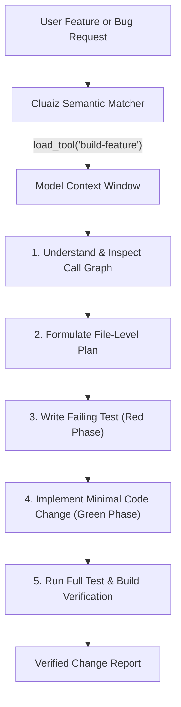

# Build Feature

Structured software engineering workflow for implementing new features and fixing bugs inside a repository: understand the requirement, inspect existing code, plan changes, write a failing test first, implement the fix, and verify the build before completion.

## Technical Specification

- **Purpose:** Prevents unverified code modifications and regressions by guiding the agent through a test-first engineering lifecycle (`Understand` -> `Plan` -> `Failing Test` -> `Implement` -> `Verify`).
- **Package Type:** Skill (`SKILL.md` procedural workflow loaded on demand)
- **Execution Mode:** Prompt-level workflow orchestration (uses workspace file and terminal tools)
- **Platform Support:** Cross-platform (Windows, macOS, Linux)
- **Runtime Dependencies:** None required by the skill itself; uses the target repository's existing build and test toolchain (`cargo`, `npm`, `pytest`, `go test`, etc.).

## System Architecture & Execution Flow



## How It Works

Unlike executable plugins that run isolated functions, `build-feature` operates as a structured engineering protocol injected into the model when the user asks to build a feature, fix a bug, or refactor code:

1. **Requirement Restatement & Code Inspection:** The model restates the goal in one or two sentences, reads the target files and their callers, and identifies how the project builds and runs tests.
2. **Scoped Planning:** Before editing multiple files, the model lists the exact files to modify and awaits confirmation if the scope is broad.
3. **Test-Driven Verification (Red -> Green):**
   - For bug fixes, it writes a test that reproduces the failure first.
   - For new features, it writes a test asserting the expected behavior.
4. **Minimal Implementation:** The model modifies only the code required for the task, matching existing repository conventions without unrelated formatting or refactoring.
5. **Final Verification:** Runs the test suite and build check, reporting exact command outputs and any remaining limitations.

## Trigger Keywords

| Category | Semantic Triggers |
|---|---|
| **Feature Development** | `add a feature`, `build a feature`, `implement`, `new feature`, `plan this` |
| **Bug Resolution & QA** | `fix this bug`, `bug fix`, `write tests`, `tdd`, `refactor` |

## Failure & Recovery Logic

- **Unclear Requirements:** Halts before editing files and asks a single targeted clarifying question if ambiguity would alter the implementation outcome.
- **Test Failures After Edit:** Reads the compiler or test runner output, diagnoses the root cause, and fixes the implementation rather than disabling or skipping the failing test.

## Installation & Usage

```bash
cluaiz skill install build-feature
```

Once installed, the Cluaiz Engine automatically matches and loads `build-feature` when you prompt:

```text
Fix the off-by-one pagination bug in src/api/users.rs and add a unit test for the last page.
```

