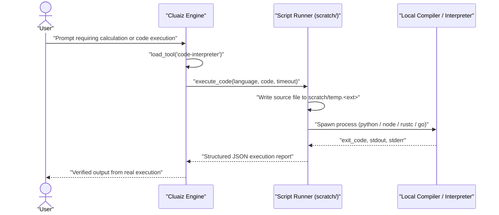

# Code Interpreter

Executes source code locally in Python, JavaScript/Node.js, TypeScript, Rust, Go, C, C++, Bash, PowerShell, PHP, Ruby, Lua, and R using the runtimes installed on the host machine, returning real `stdout`, `stderr`, and exit codes.

## Technical Specification

- **Purpose:** Eliminates mental execution guesswork by writing code to a temporary workspace scratch file, running it against the local compiler or interpreter, and returning actual process output.
- **Package Type:** Executable Skill (`script_runner`)
- **Platform Support:** Cross-platform (Windows, macOS, Linux)
- **Scratch Directory:** `<workspace>/scratch/`
- **Default Language:** `python`

## System Architecture & Execution Flow



## API Contract & Supported Languages

### Function: `execute_code`

| Parameter | Type | Required | Description |
|---|---|---|---|
| `language` | `string` | Yes | Target language identifier (`python`, `javascript`, `typescript`, `rust`, `go`, `c`, `cpp`, `powershell`, `bash`, `php`, `ruby`, `lua`, `r`). |
| `code` | `string` | Yes | Complete source code to execute. Must print final results to standard output. |
| `timeout` | `integer` | No | Maximum execution time in seconds before the process is terminated (default `30`). |

### Language Dispatch Matrix

| Language Key | File Extension | Execution Command Template |
|---|---|---|
| `python` / `py` | `.py` | `{python} "{file}"` |
| `javascript` / `js` / `node` | `.js` | `node "{file}"` |
| `typescript` / `ts` | `.ts` | `npx ts-node "{file}"` |
| `rust` / `rs` | `.rs` | `rustc "{file}" -o "{bin}" && "{bin}"` |
| `go` / `golang` | `.go` | `go run "{file}"` |
| `c` | `.c` | `gcc "{file}" -o "{bin}" && "{bin}"` |
| `cpp` / `c++` | `.cpp` | `g++ "{file}" -o "{bin}" && "{bin}"` |
| `powershell` / `ps1` / `pwsh` | `.ps1` | `powershell -File "{file}"` / `pwsh -File "{file}"` |
| `bash` / `sh` | `.sh` | `bash "{file}"` |
| `php` / `ruby` / `lua` / `r` | `.php` / `.rb` / `.lua` / `.r` | `php` / `ruby` / `lua` / `Rscript "{file}"` |

## Failure & Recovery Logic

- **Missing Local Runtime:** If the requested language compiler or interpreter is not installed on the host `PATH`, `execute_code` returns a non-zero `exit_code` and `stderr` message so the model can report the missing dependency or switch to an installed language.
- **Infinite Loops / Hangs:** Bounded by the `timeout` parameter; runaway processes are terminated when the deadline expires.
- **Permission Boundary:** Runs with the user's account permissions in the open workspace folder (`security_mode: require_approval`).

## Installation & Usage

```bash
cluaiz skill install code-interpreter
```

Example prompt:

```text
Run a Python script to benchmark SHA-256 hashing of a 10 MB buffer and print the elapsed milliseconds.
```

