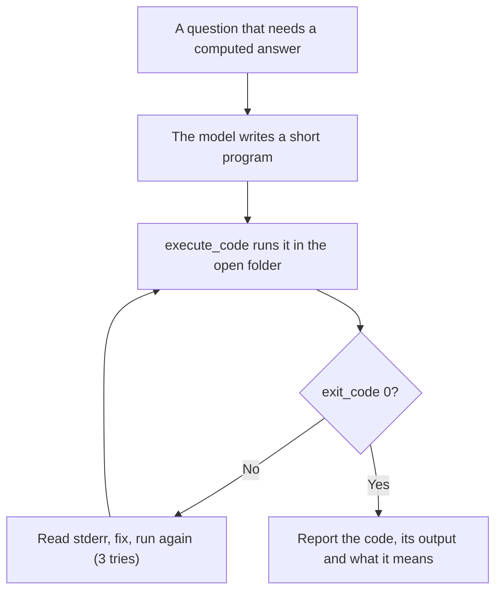

# Code Interpreter

Runs code on this computer and gives the model the real output, so answers come from running code instead of guessing: calculations, data files (CSV, JSON), summary statistics, charts, and checking that a piece of code works. Python is the default; JavaScript, TypeScript, Bash, PowerShell, Rust, Go, C, C++ and others work when their runtime is installed.

## How it works



## Function

| Function | What it does |
|---|---|
| `execute_code` | Writes the code to a temporary file in `scratch/`, runs it with the language's runtime, and returns `exit_code`, `stdout` and `stderr`. A run is stopped after 30 seconds, or after `timeout` seconds. |

## Files

| File | Read when |
|---|---|
| [references/runtimes.md](references/runtimes.md) | Languages and their runners, choosing one, installing a runtime |
| [references/data-analysis-and-charts.md](references/data-analysis-and-charts.md) | Reading data files, summary numbers, charts |
| [references/safe-runs.md](references/safe-runs.md) | What the Engine limits, and keeping long runs, big files, child processes and files safe |

## Permissions and dependencies

| Permission | At install | Info |
|---|---|---|
| Programs (`programs`): `Rscript`, `bash`, `g++`, `gcc`, `go`, `lua`, `node`, `npx`, `php`, `powershell`, `pwsh`, `python`, `ruby`, `rustc` | Not allowed, asked for (sensitive) | Runs the code it is given with that language's program. The code can do whatever that program can |
| Files (`files`): `create`, `update`, `delete` in the workspace | Not allowed, asked for (sensitive) | Writes the code to a file in the scratch folder before running it |

While a permission is refused, the Engine asks before each call. The tool runs as a normal program, so the Engine cannot block that access itself.

Allow or refuse them with `cluaiz skill permission code-interpreter [<permission> on|off]`, the App's tool page, or `tools.set_settings`. In `strict` mode every permission is asked for at install.

No dependencies.

## Install

```bash
cluaiz skill install code-interpreter
```

Needs the runtime of each language you use; Python 3 covers most tasks.

## Example prompts

- "How much is 10,000 at 7% a year after 30 years? Show a table by decade."
- "Summarize sales.csv: rows, mean and median price, and a bar chart by month."
- "Check this sort function against 1,000 random lists."

## Limits

- The code is not sandboxed: it runs with your rights in the open folder. The model is told not to delete or overwrite files you did not name.
- There is no memory limit; the model reads large files in chunks.
- Servers and programs that wait for input do not fit; a run stops at its timeout.
