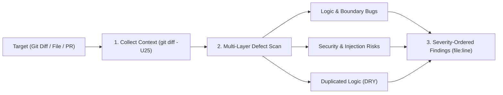

# Code Reviewer

Performs structured code reviews across local Git diffs, staged changes, specific files, or GitHub pull requests to identify logic bugs, security vulnerabilities, crashes, data loss risks, and duplicated code.

## Technical Specification

- **Purpose:** Focuses review bandwidth on defects that cause runtime failures, security exposures, or maintenance hazards rather than cosmetic formatting nitpicks.
- **Package Type:** Skill (`SKILL.md` review protocol loaded on demand)
- **Platform Support:** Cross-platform (Windows, macOS, Linux)
- **Optional Integrations:** Works with local `git` CLI, the `git` MCP server, or `gh pr diff` for GitHub pull requests.

## System Architecture & Execution Flow



## How It Works

1. **Context Acquisition:**
   - For uncommitted work, the model inspects `git status --short` and `git diff -U25` (using 25 lines of surrounding context so callers and error paths are visible).
   - For pull requests, it fetches `gh pr view` and `gh pr diff`.
2. **Defect Classification:**
   - **Correctness & Edge Cases:** Off-by-one errors, null/empty inputs, unchecked error returns, race conditions, and resource leaks.
   - **Security:** Hardcoded credentials, SQL/command injection, path traversal, missing authentication checks, and unsafe deserialization.
   - **Duplication:** Logic repeated across modules that should use an existing shared function.
3. **Actionable Reporting:** Every finding cites the exact `file:line`, explains the concrete failure scenario, and provides a direct fix. Style issues handled by linters or formatters are omitted.

## Trigger Keywords

| Category | Semantic Triggers |
|---|---|
| **Local Review** | `review this code`, `review my changes`, `check for bugs`, `code review` |
| **Security & PRs** | `audit security`, `code quality audit`, `review pr`, `security`, `bugs` |

## Failure & Recovery Logic

- **Empty Diff:** If `git diff` is empty, checks `git diff --staged` or asks the user which commit range or file path to inspect.
- **Large Diffs:** Prioritizes executable code paths and security boundaries over generated files or lockfiles.

## Installation & Usage

```bash
cluaiz skill install code-reviewer
```

Example prompt:

```text
Review my staged changes for security issues and edge-case bugs before I commit.
```

