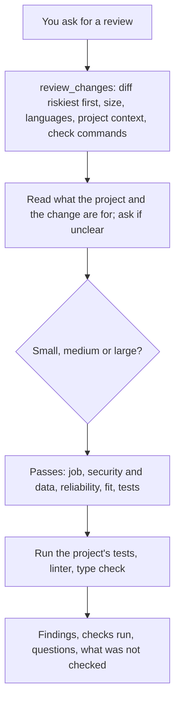

# Code Reviewer

Reviews code in any language the way a senior engineer who knows the project would: your uncommitted changes, a branch, files, pasted code or a pull request, small or large. It first reads what the project is and what the change is for (`AGENTS.md`, `.agents/` rules and memory, a PRD, spec or plan, the commits or pull request), then reviews in passes (does it do the job, security and data, reliability, fit with the project, tests), runs the project's own checks, and reports findings ranked by severity, each with the file, the line, what goes wrong and a fix. It does not change files unless you ask.

## How it works



## Function

| Function | What it does |
|---|---|
| `review_changes` | Collects uncommitted changes, or a branch's changes against `base` (such as `main`). Returns the changed files riskiest first (auth, money, data schema, public API, concurrency, CI), the size of the change (small, medium, large), the languages, the project's context files (`AGENTS.md`, `.agents/rules/` and memory, PRD, spec, plan, ADRs, `CONTRIBUTING.md`, pull request template, CI workflows), its test and lint commands, the branch's commits, a note when code changed without tests, and hints for risky added lines in many languages (shell or SQL built from strings, unsafe deserialization, unsafe C calls, ignored Go errors, force unwraps, swallowed errors, TLS checks turned off, secrets redacted, conflict markers). It only reads. |

Hints and risk tags are where to look first, not findings: the model confirms each one in the code before it reports it.

## Files

| File | Read when |
|---|---|
| [references/security.md](references/security.md) | Input from outside, SSRF, auth, web clients, secrets, resources, concurrency, numbers, crypto |
| [references/languages.md](references/languages.md) | Each language in the change: Python, JavaScript and TypeScript, Go, C and C++, Java and Kotlin, C#, Swift, PHP and Ruby, SQL, shell, Dart, Rust |
| [references/architecture-and-dry.md](references/architecture-and-dry.md) | New modules, shared helpers, project rules |

It works with other skills when they are installed: `workflow-management` for the project's `.agents/` folder and memory, `github` for pull requests, `code-interpreter` to check a behaviour with a small run.

## Install

```bash
cluaiz skill install code-reviewer
```

`review_changes` needs `git` and Python 3. Running the project's checks needs the project's own tools (such as `pytest`, `npm`, `cargo`, `go`). When a GitHub MCP server or a security scanner MCP server (Semgrep, SonarQube, Snyk) is connected, the review uses it too.

## Example prompts

- "Review my changes."
- "Review this branch against main before I merge."
- "Review pull request 45."
- "Is this function safe?" (with the code pasted)

## Limits

- A review reads code and runs the project's checks; it does not prove the code correct.
- On a large change it reviews the riskiest files first and says which files it did not review.
- The hints catch common patterns in added lines only.
