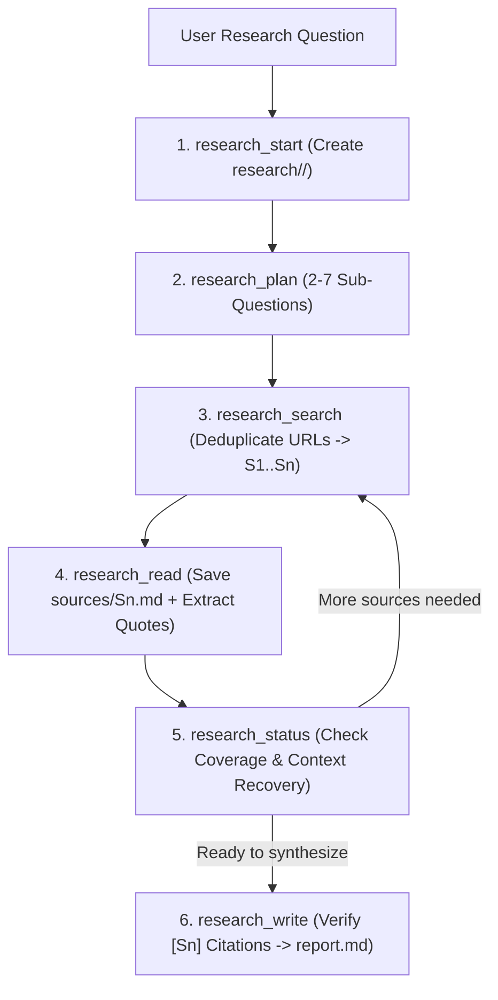

# Deep Research

Decomposes complex research questions into sub-questions, searches the web, saves full source pages to disk, verifies every inline quote against stored sources, and compiles a cited Markdown (`.md`) report in the user's workspace.

## Technical Specification

- **Purpose:** Enables multi-source technical and literature research without overflowing small model context windows (4K–16K tokens) by persisting all raw web pages, extracted facts, and progress state on disk under `<workspace>/research/<slug>/`.
- **Package Type:** Executable Skill (`script_runner` backed by `scripts/research.py`)
- **Platform Support:** Cross-platform (Windows, macOS, Linux)
- **Runtime Dependencies:** Python 3 (`{python}`)

## System Architecture & Execution Flow



## API Contract (6 Stateful Functions)

| Function | Required Parameters | Optional Parameters | Role |
|---|---|---|---|
| `research_start` | `question` | `mode` (`quick`/`standard`/`deep`), `output`, `context_tokens` | Initializes the workspace folder `research/<slug>/` and calculates per-call token budgets. |
| `research_plan` | `id`, `sub_questions` | `confirmed` | Stores 2 to 7 sub-questions on disk; in `deep` mode, pauses for user confirmation before searching. |
| `research_search` | `id`, `sub_question`, `query` | — | Queries web search providers, deduplicates URLs across the project, and assigns stable citation IDs (`S1`, `S2`, ...). |
| `research_read` | `id`, `source` | `sub_question` | Downloads the full web page to `sources/Sn.md` and returns only the highest-scoring passages with verbatim quotes. |
| `research_status` | `id` | — | Reads disk state (`project.json`) so the model can resume seamlessly even if the conversation context was truncated. |
| `research_write` | `id` | `section`, `text`, `sections`, `output`, `finalize` | Writes individual sections or finalizes the report, verifying that every `[Sn]` citation points to a real downloaded source. |

## Disk Layout

```text
<workspace>/research/<slug>/
├── state.json         # Question, mode, sub-questions, budget and progress
├── sources.json       # Source registry (S1..Sn), also written as sources.csv
├── notes.jsonl        # Facts and exact quotes taken from read pages
├── sources/
│   ├── S1.md          # Full text of fetched source S1
│   └── S2.md          # Full text of fetched source S2
├── sections/          # Sections written by the model
└── report.md          # Final verified Markdown report with bibliography
```

## Failure & Recovery Logic

- **Context Truncation Recovery:** Because all state lives on disk, calling `research_status` restores full progress at any point.
- **The report is always written:** `research_write` with `finalize: true` never refuses. A section the model did not write is made from up to three saved quotes, and a sub-question with no sources says "Not enough sources were found for this question". The result names both.
- **Citation Verification:** Unknown `[Sn]` tags are removed from a section, and a section with no valid tag is written from the notes instead.
- **A step budget:** each mode has a budget of searches and reads (quick: 3 sub-questions, one search and two reads each). Once it is used, every result tells the model to finalize.
- **Bad searches:** a search that finds no new source related to the query says so and tells the model to move on.
- **Blocked Web Pages:** If a URL blocks automated fetching, `research_read` records the failure on disk so the agent can select an alternate source.

## Search key

Without a search key, searches fall back to DuckDuckGo, which blocks after a few queries, and then Wikipedia. For dependable research, add a free key or a SearXNG server:

```bash
cluaiz plugin config web-search TAVILY_API_KEY
```

When search fails, the result tells the model to search with the browser tool (`agent_browser_open`) if it has it, or to ask the user to install it (`cluaiz mcp install browser`). The skill never installs anything itself.

## Installation & Usage

```bash
cluaiz skill install deep-research
```

Example prompt:

```text
Do deep research comparing SQLite WAL mode and LMDB memory-mapped B+trees for embedded Rust storage, and save the cited report to storage-comparison.md.
```

