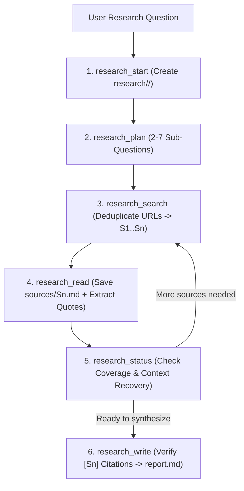

# Deep Research

Decomposes complex research questions into sub-questions, searches the web, saves full source pages to disk, verifies every inline quote against stored sources, and compiles a cited Markdown (`.md`) report in the user's workspace.

## Technical Specification

- **Purpose:** Enables multi-source technical and literature research without overflowing small model context windows (4K–16K tokens) by persisting all raw web pages, extracted facts, and progress state on disk under `<workspace>/research/<slug>/`.
- **Package Type:** Executable Skill (`script_runner` backed by `scripts/research.py`)
- **Platform Support:** Cross-platform (Windows, macOS, Linux)
- **Runtime Dependencies:** Python 3 (`{python}`)

## System Architecture & Execution Flow



## API Contract (6 Stateful Functions)

| Function | Required Parameters | Optional Parameters | Role |
|---|---|---|---|
| `research_start` | `question` | `mode` (`quick`/`standard`/`deep`), `output`, `context_tokens` | Initializes the workspace folder `research/<slug>/` and calculates per-call token budgets. |
| `research_plan` | `id`, `sub_questions` | `confirmed` | Stores 2 to 7 sub-questions on disk; in `deep` mode, pauses for user confirmation before searching. |
| `research_search` | `id`, `sub_question`, `query` | — | Queries web search providers, deduplicates URLs across the project, and assigns stable citation IDs (`S1`, `S2`, ...). |
| `research_read` | `id`, `source` | `sub_question` | Downloads the full web page to `sources/Sn.md` and returns only the highest-scoring passages with verbatim quotes. |
| `research_status` | `id` | — | Reads disk state (`project.json`) so the model can resume seamlessly even if the conversation context was truncated. |
| `research_write` | `id` | `section`, `text`, `sections`, `output`, `finalize` | Writes individual sections or finalizes the report, verifying that every `[Sn]` citation points to a real downloaded source. |

## Disk Layout

```text
<workspace>/research/<slug>/
├── project.json       # Sub-questions, source registry (S1..Sn), and completion state
├── sources/
│   ├── S1.md          # Full text of fetched source S1
│   └── S2.md          # Full text of fetched source S2
├── sections/          # Drafted report sections
└── report.md          # Final verified Markdown report with bibliography
```

## Failure & Recovery Logic

- **Context Truncation Recovery:** Because all state lives in `project.json` and `sources/`, calling `research_status` restores full progress at any point.
- **Citation Verification:** `research_write` checks every `[Sn]` tag in the draft against the registered `sources/` directory and flags uncited claims or invalid source numbers before finalizing.
- **Blocked Web Pages:** If a URL blocks automated fetching, `research_read` records the failure on disk so the agent can select an alternate source.

## Installation & Usage

```bash
cluaiz skill install deep-research
```

Example prompt:

```text
Do deep research comparing SQLite WAL mode and LMDB memory-mapped B+trees for embedded Rust storage, and save the cited report to storage-comparison.md.
```

