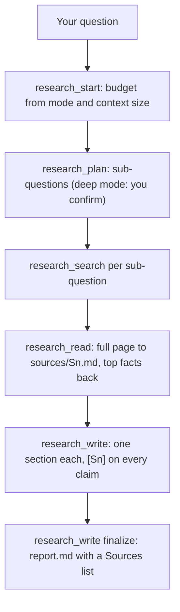

# Deep Research

Researches a question on the web and writes a cited Markdown report into your workspace. It splits the question into sub-questions, searches, saves every page it reads to disk, writes one section per sub-question with a source tag on each claim, and checks the tags against the saved pages. Only short facts reach the model, so it works with small contexts (4K, 8K, 16K).

## How it works



## Functions

| Function | What it does |
|---|---|
| `research_start` | Creates `research/<id>/` and sets the budget from `mode` and `context_tokens` |
| `research_plan` | Saves the sub-questions; in `deep` mode it waits for `confirmed: true` |
| `research_search` | Searches through the `web-search` plugin and lists sources `S1`, `S2`, ... |
| `research_read` | Saves a page to `sources/Sn.md` and returns its most relevant facts |
| `research_status` | Rebuilds where the research is from disk |
| `research_write` | Saves a section, or with `finalize: true` writes and checks the report |

## Files

| File | Read when |
|---|---|
| [references/research-method.md](references/research-method.md) | Budgets and modes, splitting the question, choosing sources, writing sections |

## Permissions and dependencies

| Permission | At install | Info |
|---|---|---|
| Internet (`network`): full: any public host | Allowed | Searches and downloads the pages the research needs |
| Files (`files`): `create`, `read`, `update` in the workspace | Not allowed, asked for (sensitive) | Saves the sources and the report in the workspace, and reads them back |
| Engine methods (`engine`): `tools.call` | Allowed | Searches through the web-search plugin when it is installed |

While a permission is refused, the Engine asks before each call. The tool runs as a normal program, so the Engine cannot block that access itself.

Allow or refuse them with `cluaiz skill permission deep-research [<permission> on|off]`, the App's tool page, or `tools.set_settings`. In `strict` mode every permission is asked for at install.

| Depends on | Need | Info |
|---|---|---|
| `web-search` (plugin) | recommended | Searches with more providers and the user's keys; without it the skill searches DuckDuckGo itself |
| `browser` (mcp) | optional | Searches and reads pages in a real browser when the search services fail or are blocked |
| `fetch` (mcp) | optional | Reads pages that need no JavaScript |

A `required` tool is installed with this one (asked first in `sandboxed` mode when it needs a sensitive permission, and in `strict` mode). A `recommended` one is asked about, except in `full_access` mode. An `optional` one is only suggested.

## Install

```bash
cluaiz skill install deep-research
cluaiz plugin install web-search
cluaiz plugin config web-search TAVILY_API_KEY    # optional, gives better search results
```

Needs Python 3. Without a search key, search falls back to fewer sources. With the `browser` MCP server installed, the model can read search result pages itself.

## Example prompts

- "Research how SQLite and DuckDB handle concurrent writes and save a report."
- "Deep research: open-source speech-to-text models that run on a laptop, with sources."

## Limits

- The report covers only what the sources it read say; the model is told not to add facts from memory.
- Search quality depends on the search provider and key.
