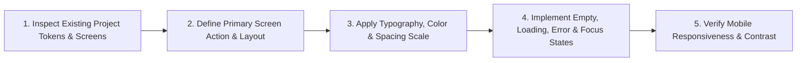

# Frontend Design

Engineering guidelines for building and refining web pages, dashboards, and application screens with consistent visual hierarchy, typography, spacing, interactive states, responsiveness, and accessibility.

## Technical Specification

- **Purpose:** Ensures generated UI components and pages integrate cleanly into an existing project's design system and handle all real-world interface states (loading, empty, error, keyboard focus, and mobile viewports).
- **Package Type:** Skill (`SKILL.md` UI engineering specification loaded on demand)
- **Platform Support:** Cross-platform (applies to React, Next.js, Vue, Svelte, Tailwind CSS, and plain HTML/CSS)
- **Runtime Dependencies:** None

## System Architecture & Workflow



## Core Engineering Rules

| Dimension | Standard Enforced by the Skill |
|---|---|
| **Project Consistency** | Inspects existing components, CSS variables, fonts, and framework conventions before introducing new styles. |
| **Visual Hierarchy** | Establishes one primary action per screen with clear typographic contrast between headings, body copy, and metadata. |
| **Interactive States** | Requires explicit handling for `empty`, `loading`, `error`, `disabled`, `hover`, and `:focus-visible` keyboard navigation states. |
| **Responsiveness** | Layouts adapt cleanly from 320px mobile viewports to desktop monitors without horizontal overflow. |
| **Accessibility (a11y)** | Enforces semantic HTML elements (`<button>`, `<nav>`, `<main>`), form `<label>` associations, and readable color contrast. |

## Trigger Keywords

`design a page`, `landing page`, `ui`, `frontend`, `make it look better`, `css`, `tailwind`, `react component`, `dashboard design`, `web page design`

## Failure & Recovery Logic

- **Design System Mismatch:** Always reads at least two existing screens or the project's theme configuration (`tailwind.config`, `globals.css`) first so new components do not clash with existing styles.
- **Small models and small contexts:** the page is written to a file with `write_file`, in one call. A whole page is long, so a small model with an 8K context can run out of room before the call is complete, and then nothing is written; with Qwen3 4B and an 8K context this happened in our tests. Use a larger context (`-c 16384` or more) or a larger model, or ask for one section at a time.

## Installation & Usage

```bash
cluaiz skill install frontend-design
```

Example prompt:

```text
Redesign the settings page in src/app/settings/page.tsx to include loading, empty, and error states while matching our existing theme.
```

