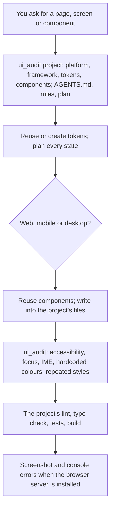

# Frontend Design

Rules and a checker for user interfaces that fit the project, look finished and work for everyone: layout, type, colour tokens, spacing, every interaction state, themes, responsiveness and accessibility, for web pages, mobile apps (React Native, Flutter, SwiftUI, Compose) and desktop apps (Tauri, Electron, native). It reads the project's design system, rules and plans first, reuses its tokens and components, keeps one source for each value, runs the project's checks, and keeps confirmed design decisions as project memory.

## How it works



## Function

| Function | What it does |
|---|---|
| `ui_audit` | Reads HTML, JSX/TSX, Vue, Svelte, CSS, Dart (Flutter), Swift and Kotlin files in a file or folder. Reports what the project has (platform, framework, token or theme files, component folders) and, with file and line: images without a text alternative, icon buttons without a name, inputs without a label, clickable elements that are not buttons, Enter handlers that submit while an IME is composing, `outline: none` without another focus style, viewports that block zoom, autoplaying video with sound, positive `tabIndex`, spacing off the 4px grid, colours written outside the token files, and the same CSS declarations repeated under different selectors. It changes nothing. |

The findings are pattern checks; the model confirms each one in the code. Contrast, layout and real keyboard and screen reader use need the running app.

## Files

| File | Read when |
|---|---|
| [references/universal-foundation.md](references/universal-foundation.md) | Where the project keeps its design, choosing a direction, spacing, type, colour, states, accessibility, one source per value, motion, languages, avoiding the generated look |
| [references/web-platform.md](references/web-platform.md) | Web: Modern Web Guidance, native dialogs and popovers, input, Core Web Vitals, structure, checks |
| [references/mobile-app.md](references/mobile-app.md) | Mobile: safe areas, touch targets, iOS and Android conventions, text scaling, lists, checks |
| [references/desktop-software.md](references/desktop-software.md) | Desktop: windows, density, keyboard, menus, Electron and Tauri security, checks |

## Permissions and dependencies

| Permission | At install | Info |
|---|---|---|
| Files (`files`): `read` in the workspace | Allowed | Reads the project's markup and styles to check them |

While a permission is refused, the Engine asks before each call. The tool runs as a normal program, so the Engine cannot block that access itself.

Allow or refuse them with `cluaiz skill permission frontend-design [<permission> on|off]`, the App's tool page, or `tools.set_settings`. In `strict` mode every permission is asked for at install.

| Depends on | Need | Info |
|---|---|---|
| `browser` (mcp) | recommended | Opens the page to check how it looks and to find console errors |
| `web-search` (plugin) | optional | Studies similar products for patterns |

A `required` tool is installed with this one (asked first in `sandboxed` mode when it needs a sensitive permission, and in `strict` mode). A `recommended` one is asked about, except in `full_access` mode. An `optional` one is only suggested.

## Install

```bash
cluaiz skill install frontend-design
```

`ui_audit` needs Python 3. With the `browser` MCP server (`cluaiz mcp install browser`) the model can open the page, take a screenshot and read console errors (it cannot change the window size); with the `web-search` plugin it can look at similar products. With Node.js it can use Modern Web Guidance (`npx modern-web-guidance`), and a Playwright, Chrome DevTools or Figma MCP server is used when one is connected. It works with `workflow-management` for the project's `.agents/` folder and memory.

## Example prompts

- "Build a pricing page for this app, using our Tailwind setup."
- "Check src/components for accessibility problems and repeated styles."
- "Make the settings screen of this Flutter app work with large text."

## Limits

- `ui_audit` reads source files; it does not render them.
- The rules are defaults. When the project's design system says otherwise, the project wins.
