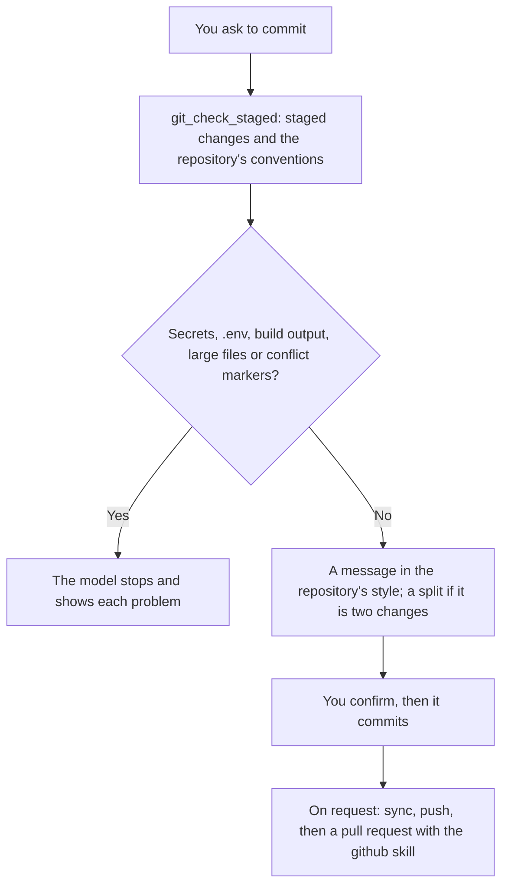

# Git Assistant

Works with git the way your repository does. It reads the repository's commit style, `CONTRIBUTING.md`, commitlint config, hooks and `.agents/` rules first, checks staged changes for secrets and build output before a commit, writes commit messages in the repository's style, helps split work into clean commits, starts branches, syncs and pushes, resolves merge conflicts, and undoes mistakes the safe way. The model commits, rebases or pushes only when you ask for that step. Pull requests, issues and CI are handled by the `github` skill.

## How it works



## Function

| Function | What it does |
|---|---|
| `git_check_staged` | Reads the staged diff and reports secrets (redacted: only the first 4 characters are shown), `.env` and key files, `node_modules/`, `target/` and other build output, files over 5 MB, leftover conflict markers, lines changed per file, and a hint when the files touch several areas. It also returns the repository's conventions: the style of recent commit subjects, files such as `CONTRIBUTING.md`, commitlint config and pull request template, active hooks, commit signing, and how far the branch is ahead of or behind its upstream. It changes nothing. |

It runs `git` and Python 3 in the open folder. The model runs other `git` commands through the terminal agent's `run_command` or the `git` MCP server.

## Files

| File | Read when |
|---|---|
| [references/git-details.md](references/git-details.md) | Secrets that were staged or committed, one change per commit, branch names and tidying history, resolving conflicts |

## Permissions and dependencies

| Permission | At install | Info |
|---|---|---|
| Programs (`programs`): `git` | Not allowed, asked for (sensitive) | Runs git to check the staged changes and the repository |
| Files (`files`): `read` in the workspace | Allowed | Reads the repository's commit rules and configuration |

While a permission is refused, the Engine asks before each call. The tool runs as a normal program, so the Engine cannot block that access itself.

Allow or refuse them with `cluaiz skill permission git-assistant [<permission> on|off]`, the App's tool page, or `tools.set_settings`. In `strict` mode every permission is asked for at install.

| Depends on | Need | Info |
|---|---|---|
| `git` (mcp) | optional | Git tools, when commands cannot be run |

A `required` tool is installed with this one (asked first in `sandboxed` mode when it needs a sensitive permission, and in `strict` mode). A `recommended` one is asked about, except in `full_access` mode. An `optional` one is only suggested.

## Install

```bash
cluaiz skill install git-assistant
```

Needs `git` and Python 3 on the computer.

## Example prompts

- "Check what I staged and write a commit message."
- "Start a branch for this fix, commit it and push it."
- "Help me resolve the conflicts from merging main."
- "I committed to the wrong branch; fix it."

## Limits

- The secret check uses patterns. It finds common key formats and `password = "..."` style values, not every secret.
- Interactive commands such as `git rebase -i` open an editor the model cannot drive; the model suggests them for you to run.
