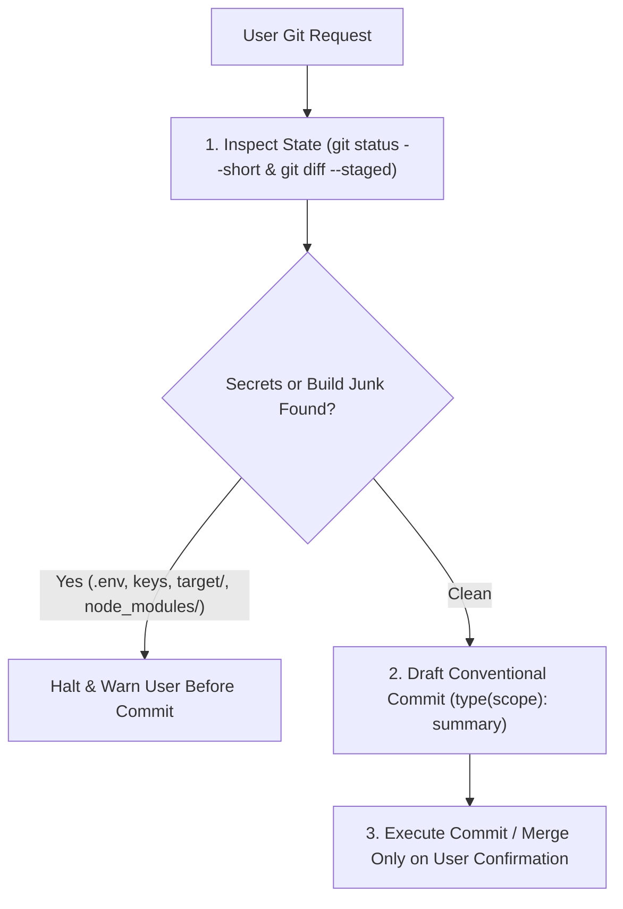

# Git Assistant

Guides safe local Git workflows: auditing staged changes for secrets or build artifacts, drafting Conventional Commit messages, and resolving merge conflicts cleanly.

## Technical Specification

- **Purpose:** Prevents accidental credential leaks, compiled binary commits, and tangled multi-feature commits while assisting with merge conflict resolution.
- **Package Type:** Skill (`SKILL.md` workflow specification loaded on demand)
- **Platform Support:** Cross-platform (Windows, macOS, Linux)
- **Integrations:** Uses `git` via terminal commands or the `git` MCP server if installed.

## System Architecture & Workflow



## Core Capabilities

| Workflow | Steps Executed |
|---|---|
| **Pre-Commit Safety Audit** | Inspects staged files and blocks the commit if API keys, `.env` files, private certificates, `node_modules/`, or `target/` build outputs are staged. |
| **Conventional Commit Drafting** | Summarizes the actual staged diff into `type(scope): description` (`feat`, `fix`, `docs`, `refactor`, `test`, `chore`) under 72 characters. |
| **Merge Conflict Resolution** | Lists conflicted files with `git diff --name-only --diff-filter=U`, reads both sides (`<<<<<<<`, `=======`, `>>>>>>>`), explains the conflict, and resolves it without leaving conflict markers behind. |

## Trigger Keywords

`git commit`, `commit message`, `git status`, `git diff`, `audit diff`, `resolve conflict`, `merge conflict`, `conventional commit`

## Failure & Recovery Logic

- **Accidental Destructive Operations:** Never runs `git commit`, `git merge`, `git reset`, or branch mutations unless explicitly requested by the user.
- **Unrelated Changes Mixed in Diff:** Advises staging related files separately so each commit has a single clear purpose.

## Installation & Usage

```bash
cluaiz skill install git-assistant
```

Example prompt:

```text
Check my staged changes for any accidentally included secrets and write a conventional commit message.
```

