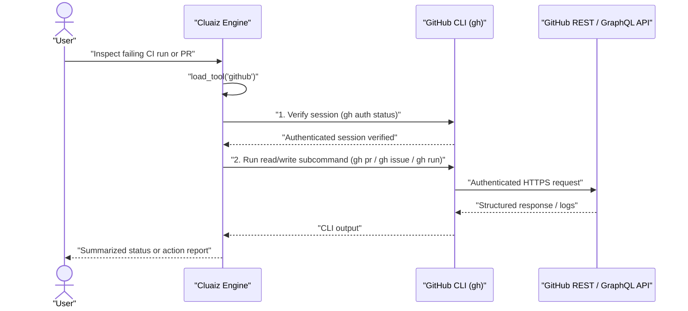

# GitHub

Interacts with GitHub repositories, issues, pull requests, code reviews, workflow runs, and search using the official GitHub CLI (`gh`).

## Technical Specification

- **Purpose:** Enables direct inspection and management of GitHub pull requests, issues, and CI workflow logs using the user's existing `gh` authentication without handling raw personal access tokens in prompts.
- **Package Type:** Skill (`SKILL.md` CLI orchestration workflow)
- **Platform Support:** Cross-platform (Windows, macOS, Linux)
- **Runtime Dependencies:** [GitHub CLI (`gh`)](https://cli.github.com) installed and authenticated via `gh auth login`.

## System Architecture & Execution Flow



## Supported Operations

| Domain | Commands Used |
|---|---|
| **Authentication Check** | `gh auth status` (prompts user to run `gh auth login` if unauthenticated; never asks for raw tokens). |
| **Pull Requests** | `gh pr list`, `gh pr view <num>`, `gh pr diff <num>`, `gh pr checks <num>`, `gh pr create`. |
| **Issues** | `gh issue list`, `gh issue view <num> --comments`, `gh issue create`. |
| **CI & GitHub Actions** | `gh run list`, `gh run view <id>`, `gh run view <id> --log-failed` to pinpoint exact failing steps. |
| **Search** | `gh search repos`, `gh search issues`, `gh search prs`, `gh search code`. |

## Failure & Recovery Logic

- **Missing or Unauthenticated `gh` CLI:** Checks `gh auth status` first; if `gh` is missing or logged out, provides the exact install or login command instead of failing mid-workflow.
- **Outside a Cloned Repository:** Automatically appends `-R owner/repo` when running commands outside a local Git working tree.

## Installation & Usage

```bash
cluaiz skill install github
```

Example prompt:

```text
Check the latest failed GitHub Actions workflow run on this repo and show me why the build step failed.
```

