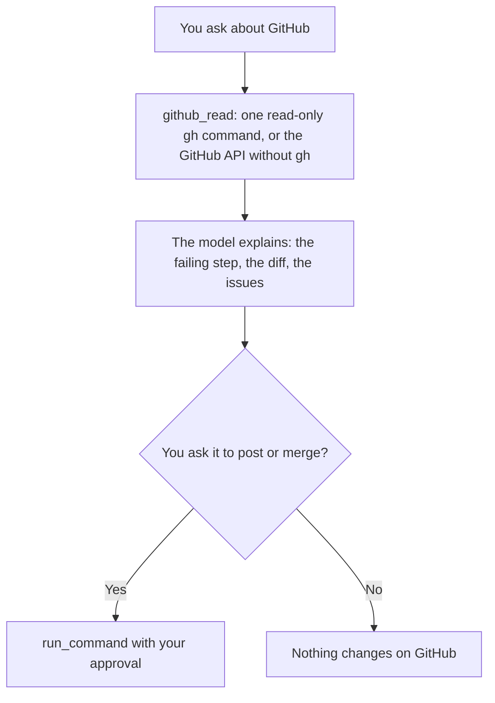

# GitHub

Works with GitHub through the GitHub CLI (`gh`), or the GitHub REST API for public repositories when `gh` is not installed: reads issues, pull requests, CI runs, releases and search results, finds why CI failed, and drafts pull request descriptions and release notes. Anything other people would see (an issue, a comment, a review, a merge) is done only when you ask, and the text is shown to you first.

## How it works



## Function

| Function | What it does |
|---|---|
| `github_read` | Runs one `gh` command that only reads: `issue list/view`, `pr list/view/diff/checks`, `run list/view` (with `--log-failed`), `search`, `repo view`, `release list/view`, and `gh api` GET requests. Commands that create, edit, comment, merge or delete are refused. Long output is cut. |

This works in chat and in the terminal agent. Writing to GitHub needs the terminal agent's `run_command`, which asks you first.

## Files

| File | Read when |
|---|---|
| [references/github-tasks.md](references/github-tasks.md) | CI failure causes, issue triage and splitting, pull request descriptions and review follow-up, versions, changelogs and releases |

## Permissions and dependencies

| Permission | At install | Info |
|---|---|---|
| Programs (`programs`): `gh`, `git` | Not allowed, asked for (sensitive) | Runs gh and git |
| Internet (`network`): strict: only `api.github.com` | Allowed | Reads public repositories from the GitHub API when gh is not installed |

While a permission is refused, the Engine asks before each call. The tool runs as a normal program, so the Engine cannot block that access itself.

Allow or refuse them with `cluaiz skill permission github [<permission> on|off]`, the App's tool page, or `tools.set_settings`. In `strict` mode every permission is asked for at install.

| Setting (`env`) | Need | Info |
|---|---|---|
| `GH_TOKEN` | optional | A GitHub token, for private repositories and a higher rate limit without gh |
| `GITHUB_TOKEN` | optional | The same as GH_TOKEN, under the other common name |

The Engine reads each from the system environment variable of that name first; otherwise set it with `cluaiz skill config github <NAME>`. Values are hidden and never stored in the tool's folder.

No dependencies.

## Install

```bash
cluaiz skill install github
```

Needs Python 3. With the GitHub CLI from https://cli.github.com, signed in with `gh auth login`, it reads everything your login can see. Without `gh`, it reads public repositories through the GitHub REST API (no CI logs or code search, and GitHub allows about 60 requests an hour without sign-in). The model never asks for a token. When a GitHub MCP server is connected, the model uses it first.

## Example prompts

- "Why did the last CI run fail?"
- "What does pull request 45 change, and are its checks green?"
- "Group the open issues by label."
- "Open a pull request for this branch with our template."
- "Draft release notes since the last tag."

## Limits

- It sees only what your `gh` login can see; without `gh`, only public repositories.
- Very long logs and diffs are cut; the model narrows them with `--limit`, `--json` or a single job.
