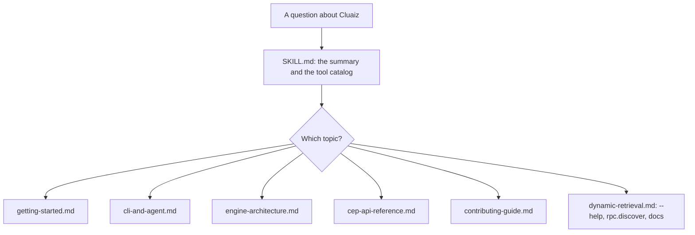

# Learn Cluaiz

Lets the model answer questions about Cluaiz itself: what it is, how to install it and run models, how the coding agent and its `.agents/` folder work, which tools exist, the HTTP API and CEP methods, and how to report bugs or contribute. The facts come from the Engine's own README and documentation; when something is not covered, the model says so and points to `cluaiz --help` or https://cluaiz.com/docs instead of guessing.

## How it works



## Files

| File | Covers |
|---|---|
| [references/getting-started.md](references/getting-started.md) | Install, supported systems, running and serving models, providers |
| [references/cli-and-agent.md](references/cli-and-agent.md) | `cluaiz agent`, modes, slash commands, `.agents/`, headless runs, flows |
| [references/engine-architecture.md](references/engine-architecture.md) | Runtimes, placement planner, speed features, repository folders |
| [references/cep-api-reference.md](references/cep-api-reference.md) | Routes, authentication, every CEP group and method, tasks |
| [references/contributing-guide.md](references/contributing-guide.md) | What is accepted during the pre-release, good reports, new tools |
| [references/dynamic-retrieval.md](references/dynamic-retrieval.md) | How the model checks anything not covered |

## Install

```bash
cluaiz skill install learn-cluaiz
```

## Example prompts

- "How do I run a model and call it from curl?"
- "What does the .agents folder hold?"
- "Which CEP method lists the installed tools?"

## Limits

- Cluaiz is in pre-release; commands and APIs can change between versions. The skill tells the model to prefer `cluaiz --help` and `rpc.discover` of the installed version.
