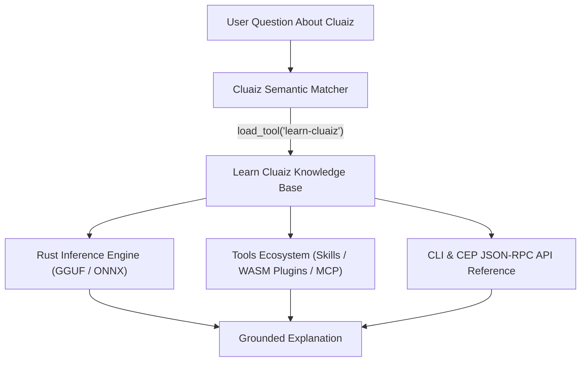

# Learn Cluaiz Guide

Built-in reference guide that explains Cluaiz's architecture, local model execution, hardware placement, CLI commands, and tool ecosystem (Skills, WebAssembly Plugins, and MCP Servers).

## Technical Specification

- **Purpose:** Provides accurate, grounded answers when a user asks how Cluaiz works, how to install models or tools, or how Skills, Plugins, and MCP servers differ.
- **Package Type:** Skill (`SKILL.md` knowledge reference loaded on demand)
- **Platform Support:** Cross-platform (Windows, macOS, Linux)
- **Runtime Dependencies:** None

## System Architecture & Knowledge Map



## Topics Covered

| Area | Details Provided |
|---|---|
| **Cluaiz Engine** | Rust-native local inference engine running GGUF and ONNX models across GPU, RAM, and CPU with automatic hardware placement. |
| **Tool Categories** | Clear distinction between **Skills** (`SKILL.md` instructions), **Plugins** (sandboxed WebAssembly modules), and **MCP Servers** (external stdio processes). |
| **CLI Commands** | Exact syntax for `cluaiz run`, `cluaiz serve`, `cluaiz skill install`, `cluaiz plugin install`, and `cluaiz mcp install`. |
| **Anti-Hallucination Rule** | Instructs the model to state clearly if a feature is not covered and direct the user to `https://cluaiz.com` rather than guessing flags or endpoints. |

## Trigger Keywords

`learn cluaiz`, `what is cluaiz`, `how does cluaiz work`, `cluaiz architecture`, `explain tools in cluaiz`, `cluaiz plugin`, `cluaiz skill`

## Installation & Usage

```bash
cluaiz skill install learn-cluaiz
```

Example prompt:

```text
What is the difference between a Cluaiz Skill, a WebAssembly Plugin, and an MCP server?
```

