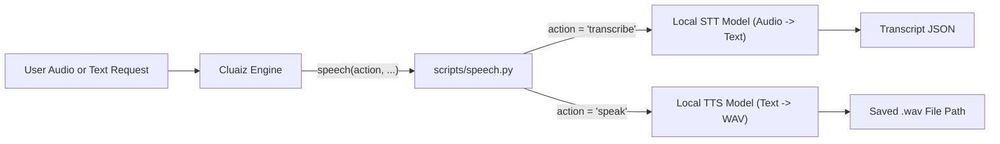

# Speech

Transcribes local audio files into text (Speech-to-Text) and synthesizes text into spoken `.wav` audio files (Text-to-Speech) using speech models installed on the host computer. All audio processing happens locally offline.

## Technical Specification

- **Purpose:** Enables offline voice transcription (`transcribe`) and speech synthesis (`speak`) without uploading audio files or text to external cloud APIs.
- **Package Type:** Executable Skill (`script_runner` backed by `scripts/speech.py`)
- **Platform Support:** Cross-platform (Windows, macOS, Linux)
- **Runtime Dependencies:** Python 3 (`{python}`) and locally installed Cluaiz speech models (`~/.cluaiz/models/`).

## System Architecture & Execution Flow



## API Contract

### Function: `speech`

| Parameter | Type | Required | Description |
|---|---|---|---|
| `action` | `string` | Yes | `"transcribe"` (audio file to text) or `"speak"` (text to `.wav` file). |
| `file` | `string` | For `transcribe` | Path to the input audio file (`.wav`, `.mp3`, `.m4a`, `.flac`, `.ogg`), relative to the workspace or absolute. |
| `text` | `string` | For `speak` | Text content to synthesize into spoken audio. |
| `output` | `string` | No | Output `.wav` file path for `"speak"` (defaults to `speech_output.wav` in the workspace). |
| `voice` | `string` | No | Optional local voice identifier for synthesis. |
| `language` | `string` | No | Optional language code (e.g., `"en"`, `"hi"`). |

## Failure & Recovery Logic

- **Missing Local Speech Model:** If no STT or TTS model is found in the local Cluaiz models directory, `scripts/speech.py` returns an explicit error message instructing the user which speech model to download first.
- **Unsupported or Missing Audio File:** Validates that the target audio file exists on disk before invoking the model and returns a structured JSON error if the path is invalid.

## Installation & Usage

```bash
cluaiz skill install speech
```

Example prompts:

```text
Transcribe recordings/standup.wav and list the action items mentioned.
```

```text
Read this summary aloud into summary.wav using the speech tool.
```

