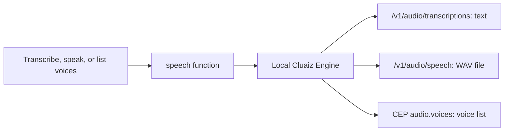

# Speech

Turns an audio file into text, and text into a spoken WAV file, with speech models running on this computer through the Cluaiz Engine. The audio is not sent online.

## How it works



## Function

| Function | What it does |
|---|---|
| `speech` | `transcribe`: an audio file (WAV, MP3, FLAC, OGG, Opus, M4A) to text; the Engine decodes and splits long recordings itself. `speak`: text to a WAV file at `output`. `voices`: the voices of the installed speech model, optionally for one `language`. |

## Files

| File | Read when |
|---|---|
| [references/engine-speech-api.md](references/engine-speech-api.md) | Formats, languages, models, errors |
| [references/tts-voice-engineering.md](references/tts-voice-engineering.md) | Choosing a voice and preparing text to be spoken |

## Permissions and dependencies

| Permission | At install | Info |
|---|---|---|
| Files (`files`): `create`, `read` in the workspace | Not allowed, asked for (sensitive) | Reads the audio file to transcribe, and saves spoken text as a WAV file |
| Engine methods (`engine`): `audio.run`, `audio.voices` | Allowed | Transcribes and speaks through the Engine's audio |

While a permission is refused, the Engine asks before each call. The tool runs as a normal program, so the Engine cannot block that access itself.

Allow or refuse them with `cluaiz skill permission speech [<permission> on|off]`, the App's tool page, or `tools.set_settings`. In `strict` mode every permission is asked for at install.

No dependencies.

## Install

```bash
cluaiz skill install speech
cluaiz pull onnx-community/moonshine-tiny-ONNX     # speech to text, English
cluaiz pull onnx-community/Kokoro-82M-v1.0-ONNX    # text to speech
cluaiz serve
```

For languages other than English, a Whisper model such as `onnx-community/whisper-large-v3-turbo` transcribes many languages. Needs Python 3.

## Example prompts

- "Transcribe meeting.mp3 and list the decisions."
- "Read this paragraph aloud into welcome.wav."
- "Which Hindi voices are there?"

## Limits

- The Engine must be running (`cluaiz serve`).
- Timestamps per segment are not returned yet.
- The model never downloads a speech model on its own; it tells you the `cluaiz pull` command.
